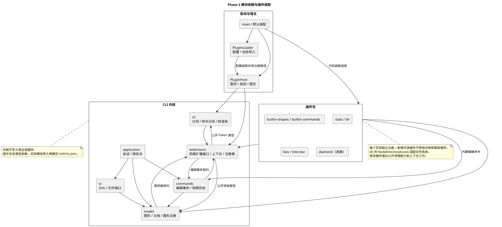
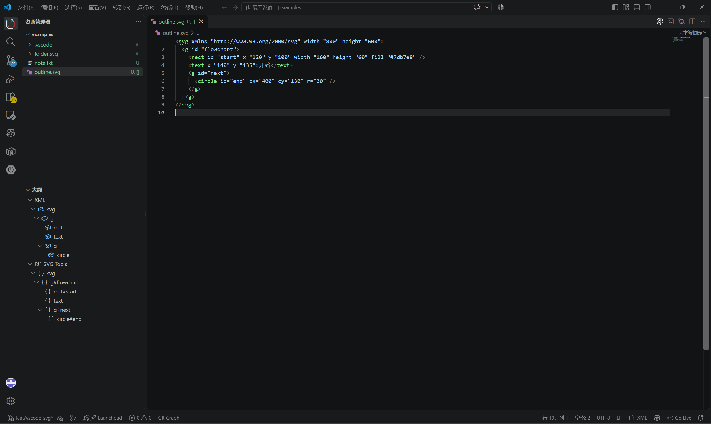
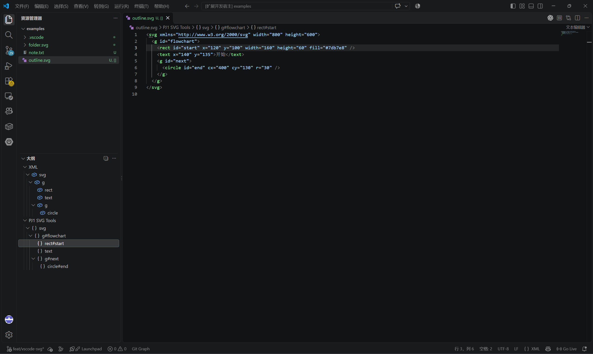

# PJ1 Phase 1：CLI SVG 编辑器

使用 TypeScript 实现命令行 SVG 编辑器，支持文档读写、基础图形编辑、分组、结构查看和撤销重做。

Phase 1 命令已接通，类型检查及 95 项测试通过，两份命令脚本已通过真实入口回放，导出 SVG 的浏览器外观检查通过。

## 运行方式

环境为 Node.js 22+，在项目根目录执行：

```powershell
npm ci
npm run check
npm run test:in-process
npm run cli
```

交互示例：

```text
svg> init 400 300
svg> create rect r1 10 20 100 50 red
svg> move r1 20 0
svg> undo
svg> tree
svg> save demo.svg
svg> quit
```

`help` 查看全部语法，`quit`、`exit` 或输入结束退出。带空格的文字和路径使用双引号，文字中可用 `\"` 表示双引号；Windows 路径的其他反斜杠保留。仅整行开头的 `#` 表示注释，颜色中的 `#` 正常保留。`create` 中未加引号的尾部 `in` 用作父容器子句，作为文字时写成 `"in"`。

`npm run demo` 回放两节点流程图并生成根目录下的 `flowchart.svg`，可用浏览器打开。管道输入时省略提示符；存在命令错误时继续处理后续输入，最终退出码为 1。无参数 `save` 使用当前文档成功 `read` 时的路径，显式另存不会改变该路径；`init` 清除读入路径，新建文档保存时必须指定文件名。

## 架构方案

### 模块划分

采用面向对象设计，一类一文件。实际模块与下表及组件图对应。

| 模块 | 职责 |
| --- | --- |
| `src/model` | 图形、分组、属性校验、文档树和几何操作 |
| `src/commands` | 编辑命令、撤销重做和历史管理 |
| `src/application` | 当前文档会话，协调编辑和文件操作 |
| `src/io` | SVG 编解码、文件读写接口及适配器 |
| `src/cli` | 输入解析、命令分发、展示和交互循环 |
| `src/main.ts` | 装配各模块 |
| `test`、`examples` | 自动化测试、示例 SVG 和命令回放案例 |


[查看 PlantUML 图源](architecture.puml)

### 设计模式

| 模式 | 选择理由 | 代码落地 |
| --- | --- | --- |
| Command | 统一管理不同编辑操作，并满足单命令撤销重做要求 | `Command` 定义接口，`MoveCommand` 等封装具体编辑，`History` 管理执行和两栈 |
| Composite | 对叶子和分组使用相同接口，支持嵌套结构 | `Shape` 为统一抽象，叶子处理自身几何，`Group` 递归移动和缩放子图形 |
| Memento | 结构编辑需同时恢复属性、父子关系和顺序 | `EditCommand` 保存前后快照，通过 `SvgDocument.clone/restore` 撤销、重做和恢复失败编辑 |
| 简单工厂 | 将类型名到具体类的映射集中管理 | `ShapeFactory` 创建六种内置图形，避免业务各处按类型分支 |

一次编辑对应一个历史单元。成功编辑清空重做栈，失败编辑恢复原状态。同一命令对象只允许成功执行一次，重做直接恢复快照。`EditorSession` 在成功 `init/read/save` 和画布尺寸修改后设置历史屏障；查询和失败操作不改变历史。

快照便于恢复结构和顺序，但会增加内存开销，当前不实现增量历史。

读写层由 `SvgCodec` 编解码、`SvgFileRepository` 协调存储，`FileStore` 定义文件端口，`NodeFileStore` 提供本地实现。导入先保留全部显式 ID，再生成缺失 ID 并返回警告；保存先序列化，再通过同目录临时文件替换目标。XML 解析使用锁定版本的 `xml-js`，并由 `XmlSyntax` 补充标签配对和重复属性校验。

CLI 的 `Tokenizer` 保留参数是否加引号，`CommandDispatcher` 集中分发命令，`ShapeFormatter` 输出结构与属性，`Repl` 管理输入循环和提示符。`main.ts` 装配会话、文件适配器与 CLI，不承载编辑规则。

### 依赖方向规则

| 模块 | 允许依赖 | 理由 |
| --- | --- | --- |
| `model` | 同层类 | 图形与树结构独立于交互、历史和文件格式 |
| `commands` | 同层、`model` | 只表达编辑行为，不承担命令行解析或文件读写 |
| `io` | 同层、`model` | 转换和存储文档，不操作命令历史 |
| `application` | 同层、`model`、`commands`、IO 仓库服务、接口及编解码器 | 通过仓库协调读写及历史屏障，具体文件适配器由入口注入 |
| `cli` | 同层、`application`、`commands`、`model` | 负责交互和展示，不直接访问文件系统 |
| `main.ts` | 各模块 | 作为装配入口连接具体实现 |
| `test` | 被测模块 | 独立验证行为，不被生产模块依赖 |


### 变化点假设

| 可能变化 | 预留与取舍 |
| --- | --- |
| 新增图形 | 通过 `Shape` 继承与工厂扩展；插件不是当前要求，暂不实现 `box` 或插件加载器 |
| 新增命令或交互入口 | 复用命令接口和历史管理，GUI 可复用模型；当前只建设 CLI，不提前引入 GUI 框架 |
| 更换存储方式 | 已通过 `FileStore` 隔离读写，具体适配器由 `main.ts` 装配；当前只需本地文件，暂不实现网络存储 |
| 大文档与长历史 | 保留快照方案的成本说明；当前优先保证结构恢复正确，暂不引入增量撤销和历史容量管理 |

### 两处名称分派及待重构项

按照作业要求，我将按名称选择实现的逻辑集中在以下两处，并将它们标记为后续待重构项：

| 分派位置 | 当前实现 | 待重构计划 |
| --- | --- | --- |
| 命令分发：`cli/CommandDispatcher.ts` | 通过 `commands` 表将命令名映射到处理逻辑 | 改为命令注册机制，增加命令时不再修改集中定义表 |
| 图形工厂：`model/ShapeFactory.ts` | 通过 `types` 表将类型名映射到具体图形的构造逻辑和参数定义 | 改为图形提供者注册机制，由提供者声明类型、参数和创建方式 |

本阶段只需要固定的命令和六种内置图形，因此我先保留集中映射，暂不实现插件加载。其他编辑操作通过 `Shape` 的统一接口和多态执行，不再按图形类型重复分支。

## 与 AI 协作的过程记录

人工负责确认任务范围、推进开发实现。AI 提供设计思路、排错参考。下表重点记录各节点的建议、落实方式与验证依据。

| 开发节点 | AI 提供的思路与建议 | 落实与验证 |
| --- | --- | --- |
| 需求分析 | 建议先核对原始说明中的语言、面向对象和设计模式约束，再划定功能范围 | 确定六类内置图形和 Phase 1 命令，`box` 与插件加载不纳入本阶段 |
| 架构设计 | 建议按模型、命令、会话、IO 和 CLI 分层 | 使用 Composite 统一容器与叶子操作，形成模块职责、依赖规则和组件图；类型创建集中在工厂，命令调用统一图形接口 |
| 图形与文档模型 | 建议封装属性与几何行为，检查唯一 ID、容器循环和分组顺序 | 建立图形类与文档树；21 项模型测试覆盖参数、结构、顺序和快照隔离 |
| 模型修订 | 提醒空分组也需校验移动参数，插入分组应检查整棵子树的 ID | 由失败用例确认两处遗漏，补充校验后，模型测试从首轮 19 项通过变为 21 项全部通过 |
| 撤销重做 | 建议用 Command 封装编辑，保存前后快照处理结构恢复 | 建立双栈历史和失败恢复；成功编辑清空重做，失败编辑保留文档及历史状态 |
| 命令修订 | 建议检查命令对象重复执行、连续撤销重做和组缩放中途溢出 | 增加 19 项命令测试，发现重复执行覆盖快照；加入执行检查后，累计 40 项测试通过 |
| 保存语义修订 | 对照题目核对无参数保存的目标，补充“读入 A、另存 B、再无参数保存”的场景 | 改为只在成功 `read` 时记录默认路径，另存不改变读入路径；新增 3 项回归测试后，累计 95 项测试通过 |
| SVG 读写 | 建议预留全部显式 ID 后再补 ID，集中处理 XML 转义，并采用临时文件替换保存 | 完成编解码与文件端口；补充未闭合标签和重复属性检查，20 项读写测试通过 |
| 会话与 CLI | 建议区分成功文档操作、查询与失败操作的历史影响；解析时保留引号信息 | 接通全部命令；修复末尾 `in` 歧义与 EOF 后提示符错误，11 项会话及 21 项 CLI 测试通过 |
| 测试环境 | 建议显式配置 Node 类型；遇到 `spawn EPERM` 时使用同进程测试模式 | 类型检查和实际测试均通过，保留环境处理记录，不以跳过测试代替验证 |


验证结果：模型 21 项、命令 19 项、读写 20 项、会话 13 项、CLI 22 项测试通过。

## 一致性自查

### 模块划分是否与方案一致

实际目录与架构方案一致，包括 `model`、`commands`、`io`、`application`、`cli`、`main.ts`、测试和示例。测试辅助文件放在 `test/support` 中，是测试模块内部的细分，没有改变原来的模块职责。


### 依赖方向是否违反规则

我以 `src/` 下的 34 个 TypeScript 文件为检查范围，将静态导入、动态导入、`require` 和重导出与方案中的依赖规则逐项对照。下面按模块汇总结果，测试代码、构建产物和第三方库内部实现不计入这次检查。

| 模块 | 文件数 | 实际依赖 | 对照结果 |
| --- | --- | --- | --- |
| `model` | 10 | 同层类 | 符合；未依赖其他业务模块或 Node.js 接口 |
| `commands` | 12 | 同层、`model` | 符合；未依赖 CLI、会话或 IO |
| `io` | 5 | 同层、`model`、`xml-js`、Node.js 文件/路径/随机标识接口 | 符合；未依赖命令、会话或 CLI |
| `application` | 1 | `commands`、`model`、IO 仓库 `SvgFileRepository` | 原规则遗漏仓库服务，已补充说明；未直接依赖文件系统 |
| `cli` | 5 | 同层、`application`、`commands`、`model`、Node.js 终端/流接口 | 符合；未直接依赖 IO 或文件系统 |
| `main.ts` | 1 | `application`、`cli`、`io` | 符合；负责装配会话、CLI、仓库及本地文件适配器 |

这次自查发现，我原先只写了应用层可以依赖 IO 接口和编解码器，没有写清对仓库服务的依赖。实际实现中，`EditorSession` 通过 `SvgFileRepository` 完成读写，具体的 `NodeFileStore` 仍由 `main.ts` 注入。我保留这一设计，因为文件操作仍集中在 IO 层，会话层没有直接访问文件系统；同时将仓库服务补入依赖规则，记录这处方案修订。

## 功能完整性和质量保证手段


| 需求范围 | 验证方法 | 当前结果 |
| --- | --- | --- |
| 六类图形、创建与指定父容器 | 检查属性、默认样式、父级和非法参数 | 模型、命令及 CLI 测试通过 |
| 移动、缩放、属性修改 | 检查几何值、白名单和嵌套组变换 | 模型及命令测试通过 |
| 删除、分组、解组、移入、前置后置 | 比较完整树结构、父级、相对顺序与撤销结果 | 模型及命令测试通过 |
| 撤销重做与失败原子性 | 连续撤销重做、新编辑、失败编辑和中途溢出 | 命令、会话和 CLI 联动测试通过 |
| `init/read/save/canvas` | 文档切换、尺寸、路径、IO 失败及历史屏障 | 会话与 CLI 测试通过 |
| SVG 导入与导出 | 保存读回比较，缺 ID 自动分配、警告、文字转义及文件失败保护 | 读写测试及真实 CLI 回放通过 |
| `tree/show/help` 与 REPL | 检查结构和属性输出、提示符、注释、引号及统一错误格式 | CLI 测试、终端交互和批处理退出码检查通过 |

当前质量依据：

- **静态检查**：`npm run check` 通过，严格类型配置检查接口和类型一致性。
- **行为测试**：`npm run test:in-process` 通过，共 95 项（模型 21、命令 19、读写 20、会话 13、CLI 22）；断言属性、层级、顺序、历史和文件状态，不仅检查提示信息。
- **回归验证**：保留空组参数、子树 ID 冲突、命令重复执行及溢出回滚用例，防止问题再次出现。
- **结构检查**：已检查全部 34 个生产源码文件的导入关系，补全应用层对 IO 仓库的依赖说明；源代码、测试、示例和 `doc/README.md` 均已纳入版本管理。

---

## Phase 2：插件实践与插件式重构

本阶段在 Phase 1 的同一仓库继续开发，完成 VSCode SVG 扩展、CLI 插件框架、必做插件，并选做 diamond 判断框。Phase 1 的代码和报告保存在已有 `final` 标签中；本阶段最终标签使用 `p2`，已有标签不移动。目前源码已合并，文档、指标和标签正在收尾。

### 运行与目录

验证环境：Windows、Node.js 24.14.0、npm 11.9.0。TypeScript 7 用于项目编译；固定版本的 TypeScript 6 分析工具仅生成指标。

```powershell
npm.cmd ci
npm.cmd run check
npm.cmd run test:in-process
npm.cmd run cli -- --config plugins.config.json
```

不传 `--config` 时只装配 Phase 1 内置命令与六类图形；根配置依次启用 stats、dir、box、tree-star、diamond。每个可选插件可通过 `enabled: false` 单独禁用。CLI 用双引号包围带空格参数，只有整行开头的 # 是注释；quit、exit 或 EOF 退出。无参数 save 使用成功 read 的路径，显式另存不改变该路径。

| 目录 | 职责 |
| --- | --- |
| src/model | 封装图形、容器、文档树及图形注册 |
| src/commands | 编辑事务、快照与撤销重做历史 |
| src/application、src/io | 当前会话、保存点、SVG 编解码与文件端口 |
| src/cli、src/extensions | 分词与渲染；公开扩展接口、上下文和注册表 |
| src/host、src/main.ts | 代码装配、配置模块解析、插件激活事务 |
| plugins | 内置图形/命令及各独立可选插件 |
| vscode-extension | 独立构建的 SVG 文件标记与大纲扩展 |
| test、scripts、doc/transcript | 单元测试、历史指标与回放工具、会话证据 |

### 架构变化与设计决策

| 变化点 | Phase 1 | Phase 2 |
| --- | --- | --- |
| 图形创建 | ShapeFactory 集中枚举六种图形 | 提供器声明名称、参数文案、创建与读回 |
| 命令分派 | CommandDispatcher 内集中定义 | 内置与新增命令均通过类实例注册 |
| 属性语义 | Shape.set 白名单 | 先查询处理器，无命中才使用原白名单 |
| 树输出 | 渲染器固定输出 | 通过独立标签组合行尾内容 |
| 装配 | main 直接连接具体实现 | 宿主暂存、校验并发布插件，支持动态配置 |

[Phase 1 PlantUML 图源](architecture.puml) · [Phase 2 PlantUML 图源](architecture-phase2.puml)




内核可依赖公开领域抽象和扩展契约，不导入宿主或插件。插件只使用公开领域操作与扩展上下文，不依赖宿主；具体插件选择集中在组合根，PluginLoader 没有具体插件名映射。静态类型依赖也计入架构检查。真实 CLI 使用 PluginHost；DefaultShapes、DefaultDispatcher 保留为默认装配及测试便利类。

Composite 统一叶子和容器；Command 封装编辑；Memento 快照恢复属性、结构和顺序。CLI 命令接口 `src/extensions/Command.ts` 与可撤销事务接口 `src/commands/Command.ts` 分开，查询无需进入历史。图形提供器体现注册式工厂；TreeDecorator 组合标签；目录访问使用 Adapter。快照和标签内容比较以正确性优先，大文档的内存及重复比较成本是当前限制。

| ADR | 决策 |
| --- | --- |
| [001](adr/001-shape-provider.md) | 子树先解析，提供器再构造；最高读回优先级并列拒绝 |
| [002](adr/002-attribute-handler.md) | 属性多命中拒绝；一次 set 一个 undo 单元，部分失败整体恢复 |
| [003](adr/003-plugin-registration.md) | 激活后校验四类名称集合，整包发布或回滚 |
| [004](adr/004-saved-state.md) | dirty 按保存内容比较，向祖先传播；复合容器可保护部件 |
| [005](adr/005-box-invariants.md) | box 固定部件 id；无插件降级，结构错误拒绝读入 |

### 四个扩展点清单

接口位于 `src/extensions/`，实现使用类或类实例。

| 接口 | 职责与内核调用位置 | 实现 | 禁用时行为 | 契约错误 |
| --- | --- | --- | --- | --- |
| ShapeProvider | ShapeFactory.create/fromSvg 创建与读回；help 读取提供器文案 | BuiltinShapeProvider、BoxProvider、DiamondProvider | 默认仍有六类内置图形；未注册类型报未知图形；box SVG 可降级 g | 重名、非法提供器、返回类型/id 错误及最高匹配优先级并列拒绝 |
| Command | CommandDispatcher.execute 查表、校验参数并 run | RegisteredCommand、StatsCommand、DirCommand | 未加载命令不出现在 help，执行报 unknown command | 重名、非法参数规则、非法返回值拒绝；异常转换为 error |
| AttributeHandler | SetCommand.apply → AttributeRegistry.apply | BoxAttributes 的 fill/label | 原有 Shape.set 白名单继续工作，未定义属性报错 | 多命中拒绝；handles/apply 抛错整体回滚，不再尝试默认处理 |
| TreeDecorator | ShapeFormatter.tree → TreeDecoratorRegistry.suffix | BoxTypeDecorator、ModifiedStar | 不追加字符，Phase 1 tree 基线不变；show 不追加标签 | 重名、非法实例、非字符串或含换行/制表符的标签拒绝 |

### 插件装配与加载

代码装配在组合根实例化插件，经 `PluginHost.activate(plugin, manifest, options)` 注册；配置装配由 PluginLoader 动态导入默认实例后调用同一个方法，不绕过清单校验或回滚。

```json
{
  "plugins": [
    { "module": "./plugins/box" },
    { "module": "./plugins/tree-star" },
    { "module": "./plugins/diamond", "enabled": false, "options": {} }
  ]
}
```

相对路径基于配置文件目录；包名使用 Node createRequire.resolve 的 main/exports require 条件解析，再动态 import。目录入口读取本目录 package.json，文件/包入口查找最近的 package.json。插件源码需先构建，包 main 指向可加载的 JavaScript；默认导出须提供 activate。options 原样传入，语义由插件验证。

四类 contributes 名称列表缺省为空，处理器也有稳定名称。加载按配置数组顺序进行，禁用项不解析。注册先进入影子表，激活完成后比较声明与实际类别及名称集合；全部通过才发布。任何重复注册、清单不符或激活失败均撤销当前整包贡献，保留先前成功插件，并继续后续加载。并发请求串行处理，激活结束后注册入口关闭。事务只覆盖注册表，不是任意第三方副作用的安全沙箱。

| 情况 | 诊断格式，之后仍可进入 CLI |
| --- | --- |
| 模块不存在 | `error: plugin not found: <module>` |
| 没有默认导出 | `error: plugin has no default export: <module>` |
| 清单与实际不符 | `error: plugin manifest mismatch: <name> (declared: …, registered: …)` |
| 激活/求值/依赖失败 | `error: plugin failed to activate: <name> (<reason>)` |
| 同类名称重复 | `error: duplicate registration: <category>/<name>` |
| 配置语法或结构非法 | `error: invalid plugin config`，跳过全部配置项，保留默认能力 |

模块成功解析后的依赖缺失或求值错误不误报顶层模块不存在。加载诊断写入 stderr；普通命令错误继续处理后续输入，最终退出码仍按原有规则设置。

### 插件行为与边界

| 插件 | 主要行为与取舍 |
| --- | --- |
| stats | 从画布子节点深度优先遍历，叶子按 SVG tag 首次出现顺序计数；g/box 只计容器，根不计，内部叶子照常计数；不改变文档和历史 |
| dir | 零参数，无文档也可用；列进程当前目录的直接子项，包含隐藏项、不列点目录；目录在前、文件在后，各组按 UTF-16 名称升序 |
| box | create box id x y w h "标题"；必要部件为 id-rect、id-label；默认蓝框白字，标题位于 x+20、y+h/2+5；支持嵌套与整体操作 |
| box 属性与保护 | fill 修改内部矩形，label 修改内部文字，各为一个 undo 单元；直接删除/移走/重组必要部件及解组拒绝；整体删除可撤销，clone 保留 Box 类型 |
| box 读回 | 保存为 data-kind="box" 的 g；无插件降级普通组，保留属性与子树；有插件但必要部件缺失、类型错误或重复 id 则拒绝整个 read，原文档保持 |
| 两个树标签 | box 行追加 (box)；modified-star 比较当前内容和上次成功 read/save，包含结构位置与子树；新文档/节点立即标记，祖先传播，undo 回保存点消失 |
| 标签状态 | 集合与状态封装在实例字段，无模块级可变状态；根配置 box 先于 star，因此显示 (box) *；插件互不感知，按注册顺序拼接 |
| 选做 diamond | create diamond id cx cy w h [fill]，宽高为正；支持几何/样式修改、变换与历史；保存为 polygon，元数据与顶点必须一致，未装插件不静默降级；stats 显示 polygon |

`dir` 不改变文档、dirty、读入路径、cwd、历史或保存屏障。空目录输出 `(empty directory)`；失败输出 `error: cannot read directory: <path>`。符号链接不跟随目标，显示 [LINK]，其他特殊项显示 [OTHER]，排在文件后。

| Adapter 角色 | 代码 | 职责 |
| --- | --- | --- |
| Client | DirCommand | 调用目录接口并排序、格式化 |
| Target | DirectoryAccess | currentDirectory/list，不暴露 Node Dirent |
| Adapter | NodeDirectoryAccess | 将 Node 目录项转换为 DirectoryEntry |
| Adaptee | fs.readdirSync、process.cwd | 实际文件系统访问与目录查询 |

### VSCode 扩展与运行证据

```powershell
npm.cmd --prefix vscode-extension ci
npm.cmd --prefix vscode-extension run check
npm.cmd --prefix vscode-extension run test:in-process
```

用 VSCode 打开仓库根目录，按 F5 选择“调试 SVG 扩展”。开发窗口以文本方式打开 outline.svg，在 Explorer 下方展开“大纲”。重建后重新启动调试或 Reload Window。

VSCode 负责界面、编辑更新调度与定位；extension.ts 注册 FileDecorationProvider 与 DocumentSymbolProvider，并通过 subscriptions 释放资源。文件提供器只返回 [] 标记，不改文件名或内容；大纲提供器把独立解析树及字符偏移适配为 DocumentSymbol/Range。

文件装饰与经典 Decorator 都追加展示信息，但没有完整的“同接口包装原对象并转发”结构，不能仅凭名称认定为经典装饰器。大纲提供器体现 Adapter：客户端是 VSCode，被适配数据是 OutlineElement，输出是宿主符号接口。Phase 1 的解析依赖 sax 可复用，但 SvgCodec 会分配 id、限制图形且不保留源码位置，领域树不能直接用于大纲定位，因此扩展独立解析 XML，不依赖 CLI 内部实现。

我已在开发窗口观察原始大纲、验证嵌套与无 id 元素、点击定位、未保存更新和不完整 XML 恢复。下面均为实际运行截图，题目附带的 JPG 不作为证据；若同时出现 XML 与 PJ1 SVG Tools 两组大纲，本项目对应后者，U 是 Git 状态而非 SVG 标记。





[未保存编辑更新](images/vscode-svg-begin.png) · [缺闭合标签时本扩展大纲清空](images/vscode-svg-incomplete.png) · [恢复闭合标签后节点出现](images/vscode-svg-recovered.png)

### 测试、兼容性与提交证据

```powershell
npm.cmd run check
npm.cmd run test:in-process
node --test --test-isolation=none scripts/metrics.test.mjs scripts/box-session.test.mjs scripts/command-session.test.mjs
& ./scripts/check-phase1.ps1
npm.cmd run metrics
```

| 验证范围 | 结果与依据 |
| --- | --- |
| CLI | 176 项通过：保留原 95 项断言，新增扩展点、加载器、插件与边界测试 |
| VSCode | 9 项自动化测试通过，另有上述真实运行截图；替身测试不代替界面验证 |
| 指标与会话 | 4 项指标口径测试、2 项完整会话测试通过 |
| 加载器 | 四条失败路径、重复注册、整包回滚、禁用、options、相对路径、包名与配置整体预检 |
| dir | 测试替身及真实临时目录组合；成功/失败均保留状态和历史；固定目录两种装配输出一致，日志写在目录之外 |
| 属性与 box | 多部件整体 undo/redo、部分失败恢复、冲突策略、id 冲突、结构保护、读回失败和缺省降级 |
| dirty | 编辑→保存→再编辑→undo→redo、新节点、祖先传播、删除/排序/画布变化、失败 IO 和标签共存 |
| Phase 1 | 禁用新增插件，以真实 CLI 入口对照 final 回放基础及流程图会话；help/tree 等输出和生成 SVG 逐字节一致 |
| 双装配 | 命令插件会话及题目 §6.1 box 会话输出、保存 SVG 逐字节一致；diamond 也有独立装配对比 |

[会话目录](transcript/) 将输入命令、配置、初始 SVG、预期输出和保存图形分开。command-plugins.code/config.txt 对应固定目录会话；box.code/config.txt 对应题目 §6.1。回放工具为 scripts/replay-command-plugins.mjs 与 scripts/replay-box.mjs。输入无 svg> 提示符或示例输出；输出证据通过 .gitattributes 固定 LF，仍按原始字节比较。

代码接入演示分支 `demo/box-code`：提交 `d039c1c`，父版本 `f544a0c`，只新增同一 box 包及测试，运行代码仅修改 src/main.ts。配置接入提交 `7ce2bdf` 只新增插件并修改配置，没有改既有运行代码。演示分支保留供验收，不合并至 main。可复核：

```powershell
git diff --name-status d039c1c^ d039c1c
git diff --name-status 7ce2bdf^ 7ce2bdf
git diff d039c1c^ d039c1c -- src/model src/commands src/io src/application src/cli src/extensions src/host plugins/builtin-shapes plugins/builtin-commands plugins/stats plugins/dir
```

第三条应为空，且这些目录实际存在。stats、dir、box、star、diamond 接入各有普通提交，保留了开发过程。最终需确认远程 demo/box-code 可访问，不能只依赖本地记录。

### 一致性与指标自查

实际模块遵循“宿主选择实现、内核依赖契约、插件使用公开能力”的规则；创建与读回共用图形注册表，代码与配置共用激活事务。原来的两处名称枚举已移到内置插件，后续插件接入没有增加内核分支。公开 Token 类型仍位于 CLI 目录，属于显式契约类型依赖；配置加载器和插件包中的适配器分别承担允许的外部访问。

[指标报告](../docs/metrics/README.md) 与 [详细数据](../docs/metrics/metrics.json) 由 scripts/metrics.ps1 从 Git 快照生成，列出文件职责、物理行数、实现函数圈复杂度及增量；按内核/装配处/插件拆分，VSCode 单列，依赖、测试和构建产物排除。统计口径与真实提交哈希写入报告，不手填数字。静态 import/export 检查未发现内核导入宿主/插件或插件导入宿主；动态加载与具体插件无硬编码也另行人工核对。

指标先以最终源码提交为快照，文档收尾后再核对 p2 与该源码树是否一致；不为更新统计而移动已有标签。复杂度增加包含加载、校验与失败路径，不能只凭总量断言质量改善。当前限制为全量历史快照、标签重复内容比较，以及 diamond 仅支持本插件格式的 polygon。

### 与 AI 协作时的检查和修正

| 节点 | AI 辅助内容 | 我的检查、修正与验证依据 |
|---|---|---|---|
| VSCode 实践 | 提供注册API、装饰逻辑、源码范围适配的设计思路与草稿 | 观察原生大纲能力，手动核对标记、层级、定位、未保存更新、异常恢复，全程截图留存证据，独立调整代码落地 |
| 大纲排查 | 给出文件诊断、编辑器与启动配置的排查方向 | 针对“无法提供大纲信息”问题，调试验证修复方案 |
| 框架拆分 | 给出模块拆分思路：图形创建、文件读回、帮助模块解耦，再对接命令、属性、树接口 | 对照原有95项断言、历史会话用例校验，补全逻辑，防止仅修复创建入口、遗漏SVG读回链路 |
| 属性事务 | 提供多目标修改、部分失败场景的测试设计思路 | 实现冲突拒绝逻辑；测试验证：多部件批量修改归为单次undo，报错时文档状态保留、redo链路正常 |
| 加载器 | 提供暂存机制、整体校验的设计草稿 | 实现四类加载失败、重复注册、异常吞错场景；区分顶层模块缺失、依赖异常、求值失败等不同报错分支 |
| 命令与box | 提供适配器、复合结构、边界用例的设计思路 | 采用固定真实目录测试，处理派生id冲突、结构保护、降级逻辑，完整会话验证，不只校验成功提示 |
| 树标签 | 提供内容比对、状态机的测试方案思路 | 验证新建标记、祖先状态传播、注册顺序影响；测试undo回滚后，保存状态标记正常消失 |
| Windows换行 | 提示字节比对失败的排查方向 | 定位根因是CRLF/LF换行差异，手动统一校验基准为LF |
| 指标与选做 | 提供AST指标统计、diamond方案设计思路 | 实现分支统计，规避字符串/类型误统计问题；保留原有编译器，明确polygon读回、统计模块的边界限制 |