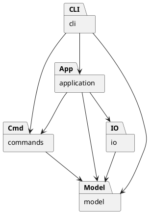

# PJ1 Phase 1：CLI SVG 编辑器

使用 TypeScript 实现命令行 SVG 编辑器，目标包括文档读写、基础图形编辑、分组、结构查看和撤销重做。

当前模型层与命令层已有代码，类型检查通过，21 项模型测试通过；CLI、SVG 读写和命令历史测试尚未完成。

## 架构方案

### 模块划分

采用面向对象设计，一类一文件。以下为目标架构，目前已有 `model`、`commands` 和模型测试。

| 模块 | 职责 |
| --- | --- |
| `src/model` | 图形、分组、属性校验、文档树和几何操作 |
| `src/commands` | 编辑命令、撤销重做和历史管理 |
| `src/application` | 当前文档会话，协调编辑和文件操作 |
| `src/io` | SVG 编解码、文件读写接口及适配器 |
| `src/cli` | 输入解析、命令分发、展示和交互循环 |
| `src/main.ts` | 装配各模块 |
| `test`、`examples` | 自动化测试和命令回放案例 |

### 设计模式

| 模式 | 代码落地 |
| --- | --- |
| Command | 具体命令封装一次编辑，`History` 管理执行、撤销和重做 |
| Composite | `Shape` 为统一抽象，叶子类处理自身几何，`Group` 递归移动和缩放子图形 |
| Memento | `EditCommand` 保存前后快照，通过 `SvgDocument.clone/restore` 恢复状态 |
| 简单工厂 | `ShapeFactory` 集中创建六种内置图形，避免各处按类型分支 |

一次编辑对应一个历史单元。成功编辑清空重做栈，失败编辑恢复原状态。文档操作成功后应设置历史屏障，查看操作不改变历史；会话层接入待完成。

快照便于恢复结构和顺序，但会增加内存开销，当前不实现增量历史。

### 依赖方向

- `model` 只依赖同层；`commands` 和 `io` 可依赖 `model`，不互相依赖。
- `application` 依赖模型、命令及 IO 接口，协调当前文档和历史。
- `cli` 可依赖会话、命令和模型，不直接读写文件；`main.ts` 负责装配。

这样可独立修改交互、编辑和存储逻辑。违反上述方向的依赖需记录并处理。

### 变化点假设

| 变化点 | 预留与取舍 |
| --- | --- |
| 新图形 | 通过继承与工厂扩展；本阶段不实现 `box` 或插件加载器 |
| 新命令或 GUI | 扩展具体命令，其他交互入口复用模型与命令 |
| 存储方式 | 计划通过文件端口隔离，暂不实现网络存储 |
| 大文档与长历史 | 已识别快照成本，暂不引入增量撤销算法 |

命令名分发和图形工厂是两处允许的名称分派，后续插件化时待重构为注册机制。

## 与 AI 协作的过程记录

| 阶段 | 讨论与处理 |
| --- | --- |
| 需求梳理 | 借助 AI 辅助工具对照作业说明，确认语言、Command、Composite 和一类一文件等约束 |
| 架构设计 | 将几何行为放入图形类，命令调用统一接口，避免数据袋与外部类型分支 |
| 撤销设计 | 选择前后快照处理分组、删除等结构恢复，同时记录复制成本 |
| 文档修订 | 发现脚本已配置容易被误读为功能可用，明确区分类型检查通过与功能测试未完成 |
| 模型验证 | 首轮测试发现空分组漏校验移动参数、插入子树漏查后代 ID；补齐校验后，21 项模型测试全部通过 |

已完成首次 GitHub 推送，后续按实际开发阶段使用中文提交说明。

## 一致性自查

1. **模块划分**：已有 `model`、`commands` 和 `test/model.test.ts` 与方案一致，其他部分尚未实施；当前未发生模块职责调整。
2. **依赖方向**：检查现有导入关系，模型只依赖同层，命令只依赖模型及同层，未发现反向依赖。其他模块实现后需补查。
3. **面向对象**：六类图形独立文件，属性和子节点集合封装；容器通过多态递归变换，类型创建集中在工厂。

## 功能完整性和质量保证手段

| 功能 | 当前状态 |
| --- | --- |
| 六类图形、移动、缩放、属性修改 | 模型行为测试通过，命令接入待验证 |
| 删除、分组、解组、归属及图层调整 | 文档模型测试通过，命令接入待验证 |
| 撤销重做 | 已有历史机制，待测试及文档操作联动 |
| 文档读写、CLI、结构展示 | 待实现 |

已执行 `npm run check` 和 `npm run test:in-process`，类型检查及 21 项模型测试通过，覆盖图形变换、参数校验、嵌套分组、ID 冲突、图层顺序和快照隔离。测试采用同进程模式，避免受限环境禁止创建测试子进程；正常环境也可使用 `npm test`。后续重点验证：

- 模型行为与命令入口的衔接，特别是错误时完整状态恢复。
- 连续撤销重做、新编辑清空重做、失败操作保持状态。
- SVG 保存读回、缺失 ID 分配和文本转义。
- 回放作业典型会话，在浏览器检查导出的 SVG。

开发环境为 Node.js 22+；安装依赖使用 `npm ci`。CLI 入口尚未建立，暂不能完整运行编辑器。

最终交付前补齐实现和验证结果，更新自查，推送源码与文档，并在最终提交处创建、推送 `final` 标签。
