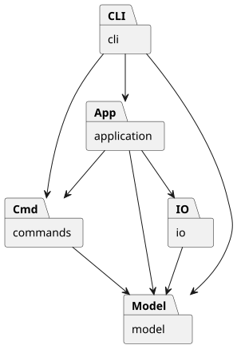

# PJ1 Phase 1：CLI SVG 编辑器

使用 TypeScript 实现命令行 SVG 编辑器，支持文档读写、基础图形编辑、分组、结构查看和撤销重做。

Phase 1 命令已接通，类型检查及 95 项测试通过，两份命令脚本已通过真实入口回放，导出 SVG 的浏览器外观检查通过。

## 运行方式

环境为 Node.js 22+，在项目根目录执行：

```powershell
npm ci
npm run check
npm run test:in-process
npm run cli
```

交互示例：

```text
svg> init 400 300
svg> create rect r1 10 20 100 50 red
svg> move r1 20 0
svg> undo
svg> tree
svg> save demo.svg
svg> quit
```

`help` 查看全部语法，`quit`、`exit` 或输入结束退出。带空格的文字和路径使用双引号，文字中可用 `\"` 表示双引号；Windows 路径的其他反斜杠保留。仅整行开头的 `#` 表示注释，颜色中的 `#` 正常保留。`create` 中未加引号的尾部 `in` 用作父容器子句，作为文字时写成 `"in"`。

`npm run demo` 回放两节点流程图并生成根目录下的 `flowchart.svg`，可用浏览器打开。管道输入时省略提示符；存在命令错误时继续处理后续输入，最终退出码为 1。无参数 `save` 使用当前文档成功 `read` 时的路径，显式另存不会改变该路径；`init` 清除读入路径，新建文档保存时必须指定文件名。

## 架构方案

### 模块划分

采用面向对象设计，一类一文件。实际模块与下表及组件图对应。

| 模块 | 职责 |
| --- | --- |
| `src/model` | 图形、分组、属性校验、文档树和几何操作 |
| `src/commands` | 编辑命令、撤销重做和历史管理 |
| `src/application` | 当前文档会话，协调编辑和文件操作 |
| `src/io` | SVG 编解码、文件读写接口及适配器 |
| `src/cli` | 输入解析、命令分发、展示和交互循环 |
| `src/main.ts` | 装配各模块 |
| `test`、`examples` | 自动化测试、示例 SVG 和命令回放案例 |


[查看 PlantUML 图源](architecture.puml)

### 设计模式

| 模式 | 选择理由 | 代码落地 |
| --- | --- | --- |
| Command | 统一管理不同编辑操作，并满足单命令撤销重做要求 | `Command` 定义接口，`MoveCommand` 等封装具体编辑，`History` 管理执行和两栈 |
| Composite | 对叶子和分组使用相同接口，支持嵌套结构 | `Shape` 为统一抽象，叶子处理自身几何，`Group` 递归移动和缩放子图形 |
| Memento | 结构编辑需同时恢复属性、父子关系和顺序 | `EditCommand` 保存前后快照，通过 `SvgDocument.clone/restore` 撤销、重做和恢复失败编辑 |
| 简单工厂 | 将类型名到具体类的映射集中管理 | `ShapeFactory` 创建六种内置图形，避免业务各处按类型分支 |

一次编辑对应一个历史单元。成功编辑清空重做栈，失败编辑恢复原状态。同一命令对象只允许成功执行一次，重做直接恢复快照。`EditorSession` 在成功 `init/read/save` 和画布尺寸修改后设置历史屏障；查询和失败操作不改变历史。

快照便于恢复结构和顺序，但会增加内存开销，当前不实现增量历史。

读写层由 `SvgCodec` 编解码、`SvgFileRepository` 协调存储，`FileStore` 定义文件端口，`NodeFileStore` 提供本地实现。导入先保留全部显式 ID，再生成缺失 ID 并返回警告；保存先序列化，再通过同目录临时文件替换目标。XML 解析使用锁定版本的 `xml-js`，并由 `XmlSyntax` 补充标签配对和重复属性校验。

CLI 的 `Tokenizer` 保留参数是否加引号，`CommandDispatcher` 集中分发命令，`ShapeFormatter` 输出结构与属性，`Repl` 管理输入循环和提示符。`main.ts` 装配会话、文件适配器与 CLI，不承载编辑规则。

### 依赖方向规则

| 模块 | 允许依赖 | 理由 |
| --- | --- | --- |
| `model` | 同层类 | 图形与树结构独立于交互、历史和文件格式 |
| `commands` | 同层、`model` | 只表达编辑行为，不承担命令行解析或文件读写 |
| `io` | 同层、`model` | 转换和存储文档，不操作命令历史 |
| `application` | 同层、`model`、`commands`、IO 仓库服务、接口及编解码器 | 通过仓库协调读写及历史屏障，具体文件适配器由入口注入 |
| `cli` | 同层、`application`、`commands`、`model` | 负责交互和展示，不直接访问文件系统 |
| `main.ts` | 各模块 | 作为装配入口连接具体实现 |
| `test` | 被测模块 | 独立验证行为，不被生产模块依赖 |


### 变化点假设

| 可能变化 | 预留与取舍 |
| --- | --- |
| 新增图形 | 通过 `Shape` 继承与工厂扩展；插件不是当前要求，暂不实现 `box` 或插件加载器 |
| 新增命令或交互入口 | 复用命令接口和历史管理，GUI 可复用模型；当前只建设 CLI，不提前引入 GUI 框架 |
| 更换存储方式 | 已通过 `FileStore` 隔离读写，具体适配器由 `main.ts` 装配；当前只需本地文件，暂不实现网络存储 |
| 大文档与长历史 | 保留快照方案的成本说明；当前优先保证结构恢复正确，暂不引入增量撤销和历史容量管理 |

### 两处名称分派及待重构项

按照作业要求，我将按名称选择实现的逻辑集中在以下两处，并将它们标记为后续待重构项：

| 分派位置 | 当前实现 | 待重构计划 |
| --- | --- | --- |
| 命令分发：`cli/CommandDispatcher.ts` | 通过 `commands` 表将命令名映射到处理逻辑 | 改为命令注册机制，增加命令时不再修改集中定义表 |
| 图形工厂：`model/ShapeFactory.ts` | 通过 `types` 表将类型名映射到具体图形的构造逻辑和参数定义 | 改为图形提供者注册机制，由提供者声明类型、参数和创建方式 |

本阶段只需要固定的命令和六种内置图形，因此我先保留集中映射，暂不实现插件加载。其他编辑操作通过 `Shape` 的统一接口和多态执行，不再按图形类型重复分支。

## 与 AI 协作的过程记录

人工负责确认任务范围、推进开发实现。AI 提供设计思路、排错参考。下表重点记录各节点的建议、落实方式与验证依据。

| 开发节点 | AI 提供的思路与建议 | 落实与验证 |
| --- | --- | --- |
| 需求分析 | 建议先核对原始说明中的语言、面向对象和设计模式约束，再划定功能范围 | 确定六类内置图形和 Phase 1 命令，`box` 与插件加载不纳入本阶段 |
| 架构设计 | 建议按模型、命令、会话、IO 和 CLI 分层 | 使用 Composite 统一容器与叶子操作，形成模块职责、依赖规则和组件图；类型创建集中在工厂，命令调用统一图形接口 |
| 图形与文档模型 | 建议封装属性与几何行为，检查唯一 ID、容器循环和分组顺序 | 建立图形类与文档树；21 项模型测试覆盖参数、结构、顺序和快照隔离 |
| 模型修订 | 提醒空分组也需校验移动参数，插入分组应检查整棵子树的 ID | 由失败用例确认两处遗漏，补充校验后，模型测试从首轮 19 项通过变为 21 项全部通过 |
| 撤销重做 | 建议用 Command 封装编辑，保存前后快照处理结构恢复 | 建立双栈历史和失败恢复；成功编辑清空重做，失败编辑保留文档及历史状态 |
| 命令修订 | 建议检查命令对象重复执行、连续撤销重做和组缩放中途溢出 | 增加 19 项命令测试，发现重复执行覆盖快照；加入执行检查后，累计 40 项测试通过 |
| 保存语义修订 | 对照题目核对无参数保存的目标，补充“读入 A、另存 B、再无参数保存”的场景 | 改为只在成功 `read` 时记录默认路径，另存不改变读入路径；新增 3 项回归测试后，累计 95 项测试通过 |
| SVG 读写 | 建议预留全部显式 ID 后再补 ID，集中处理 XML 转义，并采用临时文件替换保存 | 完成编解码与文件端口；补充未闭合标签和重复属性检查，20 项读写测试通过 |
| 会话与 CLI | 建议区分成功文档操作、查询与失败操作的历史影响；解析时保留引号信息 | 接通全部命令；修复末尾 `in` 歧义与 EOF 后提示符错误，11 项会话及 21 项 CLI 测试通过 |
| 测试环境 | 建议显式配置 Node 类型；遇到 `spawn EPERM` 时使用同进程测试模式 | 类型检查和实际测试均通过，保留环境处理记录，不以跳过测试代替验证 |


验证结果：模型 21 项、命令 19 项、读写 20 项、会话 13 项、CLI 22 项测试通过。

## 一致性自查

### 模块划分是否与方案一致

实际目录与架构方案一致，包括 `model`、`commands`、`io`、`application`、`cli`、`main.ts`、测试和示例。测试辅助文件放在 `test/support` 中，是测试模块内部的细分，没有改变原来的模块职责。


### 依赖方向是否违反规则

我以 `src/` 下的 34 个 TypeScript 文件为检查范围，将静态导入、动态导入、`require` 和重导出与方案中的依赖规则逐项对照。下面按模块汇总结果，测试代码、构建产物和第三方库内部实现不计入这次检查。

| 模块 | 文件数 | 实际依赖 | 对照结果 |
| --- | --- | --- | --- |
| `model` | 10 | 同层类 | 符合；未依赖其他业务模块或 Node.js 接口 |
| `commands` | 12 | 同层、`model` | 符合；未依赖 CLI、会话或 IO |
| `io` | 5 | 同层、`model`、`xml-js`、Node.js 文件/路径/随机标识接口 | 符合；未依赖命令、会话或 CLI |
| `application` | 1 | `commands`、`model`、IO 仓库 `SvgFileRepository` | 原规则遗漏仓库服务，已补充说明；未直接依赖文件系统 |
| `cli` | 5 | 同层、`application`、`commands`、`model`、Node.js 终端/流接口 | 符合；未直接依赖 IO 或文件系统 |
| `main.ts` | 1 | `application`、`cli`、`io` | 符合；负责装配会话、CLI、仓库及本地文件适配器 |

这次自查发现，我原先只写了应用层可以依赖 IO 接口和编解码器，没有写清对仓库服务的依赖。实际实现中，`EditorSession` 通过 `SvgFileRepository` 完成读写，具体的 `NodeFileStore` 仍由 `main.ts` 注入。我保留这一设计，因为文件操作仍集中在 IO 层，会话层没有直接访问文件系统；同时将仓库服务补入依赖规则，记录这处方案修订。

## 功能完整性和质量保证手段


| 需求范围 | 验证方法 | 当前结果 |
| --- | --- | --- |
| 六类图形、创建与指定父容器 | 检查属性、默认样式、父级和非法参数 | 模型、命令及 CLI 测试通过 |
| 移动、缩放、属性修改 | 检查几何值、白名单和嵌套组变换 | 模型及命令测试通过 |
| 删除、分组、解组、移入、前置后置 | 比较完整树结构、父级、相对顺序与撤销结果 | 模型及命令测试通过 |
| 撤销重做与失败原子性 | 连续撤销重做、新编辑、失败编辑和中途溢出 | 命令、会话和 CLI 联动测试通过 |
| `init/read/save/canvas` | 文档切换、尺寸、路径、IO 失败及历史屏障 | 会话与 CLI 测试通过 |
| SVG 导入与导出 | 保存读回比较，缺 ID 自动分配、警告、文字转义及文件失败保护 | 读写测试及真实 CLI 回放通过 |
| `tree/show/help` 与 REPL | 检查结构和属性输出、提示符、注释、引号及统一错误格式 | CLI 测试、终端交互和批处理退出码检查通过 |

当前质量依据：

- **静态检查**：`npm run check` 通过，严格类型配置检查接口和类型一致性。
- **行为测试**：`npm run test:in-process` 通过，共 95 项（模型 21、命令 19、读写 20、会话 13、CLI 22）；断言属性、层级、顺序、历史和文件状态，不仅检查提示信息。
- **回归验证**：保留空组参数、子树 ID 冲突、命令重复执行及溢出回滚用例，防止问题再次出现。
- **结构检查**：已检查全部 34 个生产源码文件的导入关系，补全应用层对 IO 仓库的依赖说明；源代码、测试、示例和 `doc/README.md` 均已纳入版本管理。
