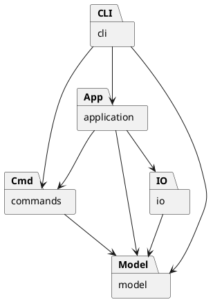

# PJ1 Phase 1：CLI SVG 编辑器

使用 TypeScript 实现命令行 SVG 编辑器，支持文档读写、基础图形编辑、分组、结构查看和撤销重做。

Phase 1 命令已接通，类型检查及 92 项测试通过，两份命令脚本已通过真实入口回放，导出 SVG 的浏览器外观检查通过。

## 运行方式

环境为 Node.js 22+，在项目根目录执行：

```powershell
npm ci
npm run check
npm run test:in-process
npm run cli
```

交互示例：

```text
svg> init 400 300
svg> create rect r1 10 20 100 50 red
svg> move r1 20 0
svg> undo
svg> tree
svg> save demo.svg
svg> quit
```

`help` 查看全部语法，`quit`、`exit` 或输入结束退出。带空格的文字和路径使用双引号，文字中可用 `\"` 表示双引号；Windows 路径的其他反斜杠保留。仅整行开头的 `#` 表示注释，颜色中的 `#` 正常保留。`create` 中未加引号的尾部 `in` 用作父容器子句，作为文字时写成 `"in"`。

`npm run demo` 回放两节点流程图并生成根目录下的 `flowchart.svg`，可用浏览器打开。管道输入时省略提示符；存在命令错误时继续处理后续输入，最终退出码为 1。无参数 `save` 使用最近一次成功读取或保存的路径，`init` 清除默认路径。

## 架构方案

### 模块划分

采用面向对象设计，一类一文件。实际模块与下表及组件图对应。

| 模块 | 职责 |
| --- | --- |
| `src/model` | 图形、分组、属性校验、文档树和几何操作 |
| `src/commands` | 编辑命令、撤销重做和历史管理 |
| `src/application` | 当前文档会话，协调编辑和文件操作 |
| `src/io` | SVG 编解码、文件读写接口及适配器 |
| `src/cli` | 输入解析、命令分发、展示和交互循环 |
| `src/main.ts` | 装配各模块 |
| `test`、`examples` | 自动化测试、示例 SVG 和命令回放案例 |



### 设计模式

| 模式 | 选择理由 | 代码落地 |
| --- | --- | --- |
| Command | 统一管理不同编辑操作，并满足单命令撤销重做要求 | `Command` 定义接口，`MoveCommand` 等封装具体编辑，`History` 管理执行和两栈 |
| Composite | 对叶子和分组使用相同接口，支持嵌套结构 | `Shape` 为统一抽象，叶子处理自身几何，`Group` 递归移动和缩放子图形 |
| Memento | 结构编辑需同时恢复属性、父子关系和顺序 | `EditCommand` 保存前后快照，通过 `SvgDocument.clone/restore` 撤销、重做和恢复失败编辑 |
| 简单工厂 | 将类型名到具体类的映射集中管理 | `ShapeFactory` 创建六种内置图形，避免业务各处按类型分支 |

一次编辑对应一个历史单元。成功编辑清空重做栈，失败编辑恢复原状态。同一命令对象只允许成功执行一次，重做直接恢复快照。`EditorSession` 在成功 `init/read/save` 和画布尺寸修改后设置历史屏障；查询和失败操作不改变历史。

快照便于恢复结构和顺序，但会增加内存开销，当前不实现增量历史。

读写层由 `SvgCodec` 编解码、`SvgFileRepository` 协调存储，`FileStore` 定义文件端口，`NodeFileStore` 提供本地实现。导入先保留全部显式 ID，再生成缺失 ID 并返回警告；保存先序列化，再通过同目录临时文件替换目标。XML 解析使用锁定版本的 `xml-js`，并由 `XmlSyntax` 补充标签配对和重复属性校验。

CLI 的 `Tokenizer` 保留参数是否加引号，`CommandDispatcher` 集中分发命令，`ShapeFormatter` 输出结构与属性，`Repl` 管理输入循环和提示符。`main.ts` 装配会话、文件适配器与 CLI，不承载编辑规则。

### 依赖方向规则

| 模块 | 允许依赖 | 理由 |
| --- | --- | --- |
| `model` | 同层类 | 图形与树结构独立于交互、历史和文件格式 |
| `commands` | 同层、`model` | 只表达编辑行为，不承担命令行解析或文件读写 |
| `io` | 同层、`model` | 转换和存储文档，不操作命令历史 |
| `application` | 同层、`model`、`commands`、IO 接口及编解码器 | 协调会话和历史屏障，具体文件适配器由入口注入 |
| `cli` | 同层、`application`、`commands`、`model` | 负责交互和展示，不直接访问文件系统 |
| `main.ts` | 各模块 | 作为装配入口连接具体实现 |
| `test` | 被测模块 | 独立验证行为，不被生产模块依赖 |

未列出的业务跨层依赖不允许，例如模型依赖命令、命令依赖 CLI。违反规则的依赖须记入自查待处理项，并移除或修订方案、说明理由。

### 变化点假设

| 可能变化 | 预留与取舍 |
| --- | --- |
| 新增图形 | 通过 `Shape` 继承与工厂扩展；插件不是当前要求，暂不实现 `box` 或插件加载器 |
| 新增命令或交互入口 | 复用命令接口和历史管理，GUI 可复用模型；当前只建设 CLI，不提前引入 GUI 框架 |
| 更换存储方式 | 已通过 `FileStore` 隔离读写，具体适配器由 `main.ts` 装配；当前只需本地文件，暂不实现网络存储 |
| 大文档与长历史 | 保留快照方案的成本说明；当前优先保证结构恢复正确，暂不引入增量撤销和历史容量管理 |

命令名分发和图形工厂是两处允许的名称分派，后续插件化时待重构为注册机制。

## 与 AI 协作的过程记录

以项目开发进展为主线，单独记录 AI 在需求核对、方案参考、实现草稿和问题排查中的辅助内容。项目进展与辅助方式分别列出，验证结论以实际检查和测试结果为准。

| 开发节点 | 项目进展 | AI 辅助内容 | 验证与修订结果 |
| --- | --- | --- | --- |
| 需求分析 | 明确六种图形、文档操作和撤销重做的阶段范围 | 协助核对作业约束，提醒 TypeScript、面向对象、一类一文件及必用设计模式 | `box` 和插件加载留到后续阶段，避免扩大实现范围 |
| 项目初始化 | 建立工程配置，完成首次 GitHub 提交与推送 | 提供配置草稿，解释依赖、暂存、提交和推送步骤 | 配置与锁文件进入仓库，依赖和构建产物通过忽略规则排除 |
| 架构设计 | 形成模型、命令、会话、IO、CLI 的模块方案 | 提供分层与组件图参考，解释 Command 和 Composite 的适用位置 | 明确模型不依赖命令和 IO，名称分派集中在两个入口 |
| 图形与文档模型 | 建立图形类、分组和文档树，支持几何变换及结构编辑 | 提供实现草稿，解释多态、属性封装及分组顺序的处理方式 | 对照需求检查统一操作，保留根级解组限制和循环拒绝规则 |
| 模型测试 | 建立 21 项模型测试 | 补充边界用例，辅助定位空组参数校验和子树 ID 检查的遗漏 | 首轮 19 项通过；修订后 21 项全部通过，回归用例保留在 `test/model.test.ts` |
| 编辑命令与历史 | 建立编辑命令、前后快照和双栈历史机制 | 提供命令实现草稿，说明快照恢复、失败回滚及内存成本 | 明确一条编辑对应一个历史单元，失败编辑不清空重做记录 |
| 命令测试 | 增加 19 项命令测试，覆盖结构恢复和历史状态 | 协助构造重复执行、连续撤销重做及中途溢出等场景，定位快照覆盖问题 | 拒绝重复成功执行同一命令后，累计 40 项测试全部通过 |
| SVG 读写 | 建立编解码器、文件端口和本地适配器，新增 20 项测试及两份示例 SVG | 提供实现草稿，辅助检查 ID 避让、文字转义、XML 合法性和保存失败保护 | 首轮 59 项中 58 项通过，发现依赖接受未闭合标签；补充语法检查并加入示例验证后，累计 60 项全部通过 |
| 会话与 CLI | 接通全部命令、结构展示及交互循环，新增 11 项会话测试、21 项 CLI 测试和两份回放脚本 | 提供实现草稿，辅助检查错误状态保持、引号与 `in` 歧义，以及 EOF 后的提示符处理 | 修复末尾 `in` 被当作颜色和 EOF 后再次提示报错的问题；累计 92 项通过，真实脚本与终端交互验证通过 |
| 测试环境 | 类型检查和测试能够实际执行 | 根据错误提示建议显式引入 Node 类型，针对 `spawn EPERM` 提供同进程运行方式 | `npm run check` 与 `npm run test:in-process` 通过，未以跳过测试代替验证 |
| 分支管理 | 按功能分支开发，通过 PR 合并阶段成果 | 解释分支与主线的关系，协助检查命令分支缺少模型提交的原因 | 合并模型 PR、同步 `main` 后更新命令分支，提交说明统一使用中文 |
| 文档整理 | 完善架构、自查和协作记录，按反馈调整篇幅与表格形式 | 协助归纳已有成果，核对文档与代码、测试状态是否一致 | 区分代码草稿、类型检查和功能验收，未将 CLI、IO 写成已完成 |
| 最终验收 | 完成主线合并后的复查，核对代码、测试、文档和导出外观 | 辅助核对需求覆盖、重跑测试与脚本，在浏览器检查生成结果并整理交付步骤 | 92 项测试和两份真实入口回放通过；Edge 中中文、颜色、图形与连线显示正常，等待提交验收记录及创建 `final` 标签 |

当前验证结果：模型 21 项、命令 19 项、读写 20 项、会话 11 项、CLI 21 项测试通过；浏览器外观与交付内容核对通过，`final` 标签需在验收记录提交后创建。

## 一致性自查

### 模块划分是否与方案一致

实际已建立 `model`、`commands`、`io`、`application`、`cli`、`main.ts`、测试和示例，与方案一致。测试辅助文件位于 `test/support`，属于原测试模块内的细分。

目前没有模块职责迁移，暂无架构修订记录。后续若实际目录或职责偏离方案，需在过程记录中补充原方案、调整原因及实际结果，并同步修改架构图。

### 依赖方向是否违反规则

检查现有源码导入关系，尚未发现已实现模块违反依赖规则。抽样依据如下：

| 抽样位置 | 实际依赖 | 自查结论 |
| --- | --- | --- |
| `model/Shape.ts` | 同层 `Value` | 符合模型只依赖同层的规则 |
| `model/SvgDocument.ts` | 同层 `Group`、`Shape`、`Value` | 未引入命令、CLI 或文件系统 |
| `commands/MoveCommand.ts` | 同层 `EditCommand`、模型 `SvgDocument` | 符合命令到模型的方向 |
| `commands/History.ts` | 同层 `Command`、模型 `SvgDocument` | 未依赖 CLI 或 IO |
| `io/SvgCodec.ts` | 模型、同层 `XmlSyntax`、XML 解析依赖 | 未引入命令历史或 CLI |
| `io/NodeFileStore.ts` | 同层 `FileStore`、Node.js 文件及路径接口 | 文件系统操作隔离在适配器内 |
| `application/EditorSession.ts` | 命令、模型、`SvgFileRepository` | 不直接依赖文件系统，由入口注入仓库 |
| `cli/CommandDispatcher.ts` | 会话、具体命令、模型校验及同层展示工具 | 名称分派集中于一个命令表，不直接读写文件 |
| `main.ts` | 会话、CLI、文件仓库和本地适配器 | 符合入口装配规则 |

六类图形独立文件，属性和子节点集合封装；容器通过多态递归变换，类型创建集中在工厂。

本阶段未发现违反依赖规则的业务导入，命令名与图形类型分派分别集中于 `CommandDispatcher` 和 `ShapeFactory`。后续若修改模块依赖，需再次检查并更新记录。

## 功能完整性和质量保证手段

通过需求与验证逐项对应确认功能完整性，不能只凭程序可启动或测试总数判断完成。

| 需求范围 | 验证方法 | 当前结果 |
| --- | --- | --- |
| 六类图形、创建与指定父容器 | 检查属性、默认样式、父级和非法参数 | 模型、命令及 CLI 测试通过 |
| 移动、缩放、属性修改 | 检查几何值、白名单和嵌套组变换 | 模型及命令测试通过 |
| 删除、分组、解组、移入、前置后置 | 比较完整树结构、父级、相对顺序与撤销结果 | 模型及命令测试通过 |
| 撤销重做与失败原子性 | 连续撤销重做、新编辑、失败编辑和中途溢出 | 命令、会话和 CLI 联动测试通过 |
| `init/read/save/canvas` | 文档切换、尺寸、路径、IO 失败及历史屏障 | 会话与 CLI 测试通过 |
| SVG 导入与导出 | 保存读回比较，缺 ID 自动分配、警告、文字转义及文件失败保护 | 读写测试及真实 CLI 回放通过 |
| `tree/show/help` 与 REPL | 检查结构和属性输出、提示符、注释、引号及统一错误格式 | CLI 测试、终端交互和批处理退出码检查通过 |

当前质量依据：

- **静态检查**：`npm run check` 通过，严格类型配置检查接口和类型一致性。
- **行为测试**：`npm run test:in-process` 通过，共 92 项（模型 21、命令 19、读写 20、会话 11、CLI 21）；断言属性、层级、顺序、历史和文件状态，不仅检查提示信息。
- **回归验证**：保留空组参数、子树 ID 冲突、命令重复执行及溢出回滚用例，防止问题再次出现。
- **结构检查**：导入关系抽查与架构一致；源代码、测试、示例和 `doc/README.md` 均已纳入版本管理。

测试使用同进程模式以适应当前环境；正常环境也可使用 `npm test`。已通过真实 `main` 入口回放基础会话和两节点流程图，并在终端验证 `svg>` 提示符、中文输入及退出。含错误的批处理会继续执行，最终返回 1；正常回放返回 0。

2026-10-23 在 Windows、Node.js 24.14.0 环境完成最终复查：类型检查、构建及 92 项测试通过，两份脚本回放退出码均为 0。通过本地预览在 Edge 检查生成的 `flowchart.svg` 和 `demo.svg`：中文与标题显示正常，节点颜色、尺寸和位置符合脚本，连线连接两节点，基础圆形及矩形显示正常，无 XML 解析错误。

读写范围：支持六种内置元素、嵌套分组、SVG 命名空间、数值或 `px` 长度及 `viewBox`。样式、字体、`transform` 等额外属性原样保留；编辑仅修改模型中的局部几何值，不解析或展开变换。注释不保留，`path`、`tspan`、百分比长度和 DOCTYPE 等不支持内容明确报错，不承诺任意 SVG 无损编辑。

示例：`examples/two-nodes.svg` 为两节点流程图，`examples/import-example.svg` 包含缺失 ID；`examples/flowchart.cli` 和 `examples/basic-session.cli` 为可回放命令。`npm run demo` 会覆盖根目录的 `flowchart.svg`，生成文件不进入版本控制。

