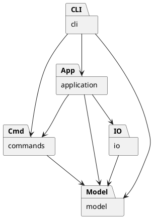

# PJ1 Phase 1：CLI SVG 编辑器

使用 TypeScript 实现命令行 SVG 编辑器，目标包括文档读写、基础图形编辑、分组、结构查看和撤销重做。

当前模型、命令与 SVG 读写层已实现，类型检查及 60 项测试通过；会话层、CLI 和端到端验证尚未完成。

## 架构方案

### 模块划分

采用面向对象设计，一类一文件。以下为目标架构，目前已有 `model`、`commands`、`io`、测试及示例；组件图中的会话和 CLI 为待实现部分。

| 模块 | 职责 |
| --- | --- |
| `src/model` | 图形、分组、属性校验、文档树和几何操作 |
| `src/commands` | 编辑命令、撤销重做和历史管理 |
| `src/application` | 当前文档会话，协调编辑和文件操作 |
| `src/io` | SVG 编解码、文件读写接口及适配器 |
| `src/cli` | 输入解析、命令分发、展示和交互循环 |
| `src/main.ts` | 装配各模块 |
| `test`、`examples` | 自动化测试、示例 SVG，后续补充命令回放案例 |

### 设计模式

| 模式 | 选择理由 | 代码落地 |
| --- | --- | --- |
| Command | 统一管理不同编辑操作，并满足单命令撤销重做要求 | `Command` 定义接口，`MoveCommand` 等封装具体编辑，`History` 管理执行和两栈 |
| Composite | 对叶子和分组使用相同接口，支持嵌套结构 | `Shape` 为统一抽象，叶子处理自身几何，`Group` 递归移动和缩放子图形 |
| Memento | 结构编辑需同时恢复属性、父子关系和顺序 | `EditCommand` 保存前后快照，通过 `SvgDocument.clone/restore` 撤销、重做和恢复失败编辑 |
| 简单工厂 | 将类型名到具体类的映射集中管理 | `ShapeFactory` 创建六种内置图形，避免业务各处按类型分支 |

一次编辑对应一个历史单元。成功编辑清空重做栈，失败编辑恢复原状态。同一命令对象只允许成功执行一次，重做直接恢复快照。历史屏障清空两栈并禁止撤销重做，文档操作和查看操作的会话层接入待完成。

快照便于恢复结构和顺序，但会增加内存开销，当前不实现增量历史。

读写层由 `SvgCodec` 编解码、`SvgFileRepository` 协调存储，`FileStore` 定义文件端口，`NodeFileStore` 提供本地实现。导入先保留全部显式 ID，再生成缺失 ID 并返回警告；保存先序列化，再通过同目录临时文件替换目标。XML 解析使用锁定版本的 `xml-js`，并由 `XmlSyntax` 补充标签配对和重复属性校验。

### 依赖方向规则

| 模块 | 允许依赖 | 理由 |
| --- | --- | --- |
| `model` | 同层类 | 图形与树结构独立于交互、历史和文件格式 |
| `commands` | 同层、`model` | 只表达编辑行为，不承担命令行解析或文件读写 |
| `io` | 同层、`model` | 转换和存储文档，不操作命令历史 |
| `application` | 同层、`model`、`commands`、IO 接口及编解码器 | 协调会话和历史屏障，具体文件适配器由入口注入 |
| `cli` | 同层、`application`、`commands`、`model` | 负责交互和展示，不直接访问文件系统 |
| `main.ts` | 各模块 | 作为装配入口连接具体实现 |
| `test` | 被测模块 | 独立验证行为，不被生产模块依赖 |

未列出的业务跨层依赖不允许，例如模型依赖命令、命令依赖 CLI。违反规则的依赖须记入自查待处理项，并移除或修订方案、说明理由。

### 变化点假设

| 可能变化 | 预留与取舍 |
| --- | --- |
| 新增图形 | 通过 `Shape` 继承与工厂扩展；插件不是当前要求，暂不实现 `box` 或插件加载器 |
| 新增命令或交互入口 | 复用命令接口和历史管理，GUI 可复用模型；当前只建设 CLI，不提前引入 GUI 框架 |
| 更换存储方式 | 已通过 `FileStore` 隔离读写，具体适配器后续由入口装配；当前只需本地文件，暂不实现网络存储 |
| 大文档与长历史 | 保留快照方案的成本说明；当前优先保证结构恢复正确，暂不引入增量撤销和历史容量管理 |

命令名分发和图形工厂是两处允许的名称分派，后续插件化时待重构为注册机制。

## 与 AI 协作的过程记录

以项目开发进展为主线，单独记录 AI 在需求核对、方案参考、实现草稿和问题排查中的辅助内容。项目进展与辅助方式分别列出，验证结论以实际检查和测试结果为准。

| 开发节点 | 项目进展 | AI 辅助内容 | 验证与修订结果 |
| --- | --- | --- | --- |
| 需求分析 | 明确六种图形、文档操作和撤销重做的阶段范围 | 协助核对作业约束，提醒 TypeScript、面向对象、一类一文件及必用设计模式 | `box` 和插件加载留到后续阶段，避免扩大实现范围 |
| 项目初始化 | 建立工程配置，完成首次 GitHub 提交与推送 | 提供配置草稿，解释依赖、暂存、提交和推送步骤 | 配置与锁文件进入仓库，依赖和构建产物通过忽略规则排除 |
| 架构设计 | 形成模型、命令、会话、IO、CLI 的模块方案 | 提供分层与组件图参考，解释 Command 和 Composite 的适用位置 | 明确模型不依赖命令和 IO，名称分派集中在两个入口 |
| 图形与文档模型 | 建立图形类、分组和文档树，支持几何变换及结构编辑 | 提供实现草稿，解释多态、属性封装及分组顺序的处理方式 | 对照需求检查统一操作，保留根级解组限制和循环拒绝规则 |
| 模型测试 | 建立 21 项模型测试 | 补充边界用例，辅助定位空组参数校验和子树 ID 检查的遗漏 | 首轮 19 项通过；修订后 21 项全部通过，回归用例保留在 `test/model.test.ts` |
| 编辑命令与历史 | 建立编辑命令、前后快照和双栈历史机制 | 提供命令实现草稿，说明快照恢复、失败回滚及内存成本 | 明确一条编辑对应一个历史单元，失败编辑不清空重做记录 |
| 命令测试 | 增加 19 项命令测试，覆盖结构恢复和历史状态 | 协助构造重复执行、连续撤销重做及中途溢出等场景，定位快照覆盖问题 | 拒绝重复成功执行同一命令后，累计 40 项测试全部通过 |
| SVG 读写 | 建立编解码器、文件端口和本地适配器，新增 20 项测试及两份示例 SVG | 提供实现草稿，辅助检查 ID 避让、文字转义、XML 合法性和保存失败保护 | 首轮 59 项中 58 项通过，发现依赖接受未闭合标签；补充语法检查并加入示例验证后，累计 60 项全部通过 |
| 测试环境 | 类型检查和测试能够实际执行 | 根据错误提示建议显式引入 Node 类型，针对 `spawn EPERM` 提供同进程运行方式 | `npm run check` 与 `npm run test:in-process` 通过，未以跳过测试代替验证 |
| 分支管理 | 按功能分支开发，通过 PR 合并阶段成果 | 解释分支与主线的关系，协助检查命令分支缺少模型提交的原因 | 合并模型 PR、同步 `main` 后更新命令分支，提交说明统一使用中文 |
| 文档整理 | 完善架构、自查和协作记录，按反馈调整篇幅与表格形式 | 协助归纳已有成果，核对文档与代码、测试状态是否一致 | 区分代码草稿、类型检查和功能验收，未将 CLI、IO 写成已完成 |

当前验证结果：模型 21 项、命令 19 项、读写 20 项测试通过；会话层和完整 CLI 尚未完成，后续继续记录相应验证与修订。

## 一致性自查

### 模块划分是否与方案一致

已有 `src/model`、`src/commands`、`src/io`、对应测试和 SVG 示例与方案一致。`application`、`cli`、`main.ts` 及命令回放案例尚未建立，属于开发未完成项，不属于已调整的架构。

目前没有模块职责迁移，暂无架构修订记录。后续若实际目录或职责偏离方案，需在过程记录中补充原方案、调整原因及实际结果，并同步修改架构图。

### 依赖方向是否违反规则

检查现有源码导入关系，尚未发现已实现模块违反依赖规则。抽样依据如下：

| 抽样位置 | 实际依赖 | 自查结论 |
| --- | --- | --- |
| `model/Shape.ts` | 同层 `Value` | 符合模型只依赖同层的规则 |
| `model/SvgDocument.ts` | 同层 `Group`、`Shape`、`Value` | 未引入命令、CLI 或文件系统 |
| `commands/MoveCommand.ts` | 同层 `EditCommand`、模型 `SvgDocument` | 符合命令到模型的方向 |
| `commands/History.ts` | 同层 `Command`、模型 `SvgDocument` | 未依赖 CLI 或 IO |
| `io/SvgCodec.ts` | 模型、同层 `XmlSyntax`、XML 解析依赖 | 未引入命令历史或 CLI |
| `io/NodeFileStore.ts` | 同层 `FileStore`、Node.js 文件及路径接口 | 文件系统操作隔离在适配器内 |

六类图形独立文件，属性和子节点集合封装；容器通过多态递归变换，类型创建集中在工厂。

待检查项：会话和 CLI 实现后的依赖方向，以及命令名称分派是否集中。最终版本需重新执行自查，不能将当前阶段结论直接作为整体通过结论。

## 功能完整性和质量保证手段

通过需求与验证逐项对应确认功能完整性，不能只凭程序可启动或测试总数判断完成。

| 需求范围 | 验证方法 | 当前结果 |
| --- | --- | --- |
| 六类图形、创建与指定父容器 | 检查属性、默认样式、父级和非法参数 | 已有模型及创建命令用例；CLI 待接入 |
| 移动、缩放、属性修改 | 检查几何值、白名单和嵌套组变换 | 模型及命令测试通过 |
| 删除、分组、解组、移入、前置后置 | 比较完整树结构、父级、相对顺序与撤销结果 | 模型及命令测试通过 |
| 撤销重做与失败原子性 | 连续撤销重做、新编辑、失败编辑和中途溢出 | 历史机制测试通过；文档操作联动待验证 |
| `init/read/save/canvas` | 文档切换、尺寸、路径、IO 失败及历史屏障 | 底层尺寸和屏障已有测试；完整命令待实现 |
| SVG 导入与导出 | 保存读回比较，缺 ID 自动分配、警告、文字转义及文件失败保护 | 20 项读写测试通过，CLI 接入待完成 |
| `tree/show/help` 与 REPL | 检查结构和属性输出、提示符、注释、引号及统一错误格式 | 待实现和验证 |

当前质量依据：

- **静态检查**：`npm run check` 通过，严格类型配置检查接口和类型一致性。
- **行为测试**：`npm run test:in-process` 通过，共 60 项（模型 21 项、命令 19 项、读写 20 项）；断言属性、层级、顺序、历史和文件状态，不仅检查提示信息。
- **回归验证**：保留空组参数、子树 ID 冲突、命令重复执行及溢出回滚用例，防止问题再次出现。
- **结构检查**：导入关系抽查与架构一致；类型检查和单元测试不能替代 CLI、文件读写及视觉验收。

测试使用同进程模式以适应当前环境；正常环境也可使用 `npm test`。最终验收还需回放原说明中的典型会话和两节点流程图，保存后在浏览器核对外观，并将结果补入本文。

读写范围：支持六种内置元素、嵌套分组、SVG 命名空间、数值或 `px` 长度及 `viewBox`。样式、字体、`transform` 等额外属性原样保留；编辑仅修改模型中的局部几何值，不解析或展开变换。注释不保留，`path`、`tspan`、百分比长度和 DOCTYPE 等不支持内容明确报错，不承诺任意 SVG 无损编辑。

示例：`examples/two-nodes.svg` 为两节点流程图；`examples/import-example.svg` 包含一个缺失 ID 的矩形。两者已通过导入测试，浏览器外观检查待最终验收。

开发环境为 Node.js 22+；安装依赖使用 `npm ci`。CLI 入口尚未建立，暂不能完整运行编辑器。

最终交付条件：完成上表待实现项，构建与全部测试通过，SVG 往返及会话回放通过，一致性自查完成。随后推送源码与文档，并在最终提交处创建、推送 `final` 标签。
