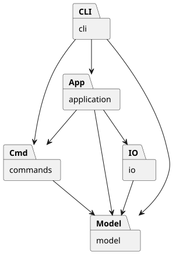

# PJ1 Phase 1：CLI SVG 编辑器

使用 TypeScript 实现命令行 SVG 编辑器，支持文档读写、基础图形编辑、分组、结构查看和撤销重做。

Phase 1 命令已接通，类型检查及 95 项测试通过，两份命令脚本已通过真实入口回放，导出 SVG 的浏览器外观检查通过。

## 运行方式

环境为 Node.js 22+，在项目根目录执行：

```powershell
npm ci
npm run check
npm run test:in-process
npm run cli
```

交互示例：

```text
svg> init 400 300
svg> create rect r1 10 20 100 50 red
svg> move r1 20 0
svg> undo
svg> tree
svg> save demo.svg
svg> quit
```

`help` 查看全部语法，`quit`、`exit` 或输入结束退出。带空格的文字和路径使用双引号，文字中可用 `\"` 表示双引号；Windows 路径的其他反斜杠保留。仅整行开头的 `#` 表示注释，颜色中的 `#` 正常保留。`create` 中未加引号的尾部 `in` 用作父容器子句，作为文字时写成 `"in"`。

`npm run demo` 回放两节点流程图并生成根目录下的 `flowchart.svg`，可用浏览器打开。管道输入时省略提示符；存在命令错误时继续处理后续输入，最终退出码为 1。无参数 `save` 使用当前文档成功 `read` 时的路径，显式另存不会改变该路径；`init` 清除读入路径，新建文档保存时必须指定文件名。

## 架构方案

### 模块划分

采用面向对象设计，一类一文件。实际模块与下表及组件图对应。

| 模块 | 职责 |
| --- | --- |
| `src/model` | 图形、分组、属性校验、文档树和几何操作 |
| `src/commands` | 编辑命令、撤销重做和历史管理 |
| `src/application` | 当前文档会话，协调编辑和文件操作 |
| `src/io` | SVG 编解码、文件读写接口及适配器 |
| `src/cli` | 输入解析、命令分发、展示和交互循环 |
| `src/main.ts` | 装配各模块 |
| `test`、`examples` | 自动化测试、示例 SVG 和命令回放案例 |


[查看 PlantUML 图源](architecture.puml)

### 设计模式

| 模式 | 选择理由 | 代码落地 |
| --- | --- | --- |
| Command | 统一管理不同编辑操作，并满足单命令撤销重做要求 | `Command` 定义接口，`MoveCommand` 等封装具体编辑，`History` 管理执行和两栈 |
| Composite | 对叶子和分组使用相同接口，支持嵌套结构 | `Shape` 为统一抽象，叶子处理自身几何，`Group` 递归移动和缩放子图形 |
| Memento | 结构编辑需同时恢复属性、父子关系和顺序 | `EditCommand` 保存前后快照，通过 `SvgDocument.clone/restore` 撤销、重做和恢复失败编辑 |
| 简单工厂 | 将类型名到具体类的映射集中管理 | `ShapeFactory` 创建六种内置图形，避免业务各处按类型分支 |

一次编辑对应一个历史单元。成功编辑清空重做栈，失败编辑恢复原状态。同一命令对象只允许成功执行一次，重做直接恢复快照。`EditorSession` 在成功 `init/read/save` 和画布尺寸修改后设置历史屏障；查询和失败操作不改变历史。

快照便于恢复结构和顺序，但会增加内存开销，当前不实现增量历史。

读写层由 `SvgCodec` 编解码、`SvgFileRepository` 协调存储，`FileStore` 定义文件端口，`NodeFileStore` 提供本地实现。导入先保留全部显式 ID，再生成缺失 ID 并返回警告；保存先序列化，再通过同目录临时文件替换目标。XML 解析使用锁定版本的 `xml-js`，并由 `XmlSyntax` 补充标签配对和重复属性校验。

CLI 的 `Tokenizer` 保留参数是否加引号，`CommandDispatcher` 集中分发命令，`ShapeFormatter` 输出结构与属性，`Repl` 管理输入循环和提示符。`main.ts` 装配会话、文件适配器与 CLI，不承载编辑规则。

### 依赖方向规则

| 模块 | 允许依赖 | 理由 |
| --- | --- | --- |
| `model` | 同层类 | 图形与树结构独立于交互、历史和文件格式 |
| `commands` | 同层、`model` | 只表达编辑行为，不承担命令行解析或文件读写 |
| `io` | 同层、`model` | 转换和存储文档，不操作命令历史 |
| `application` | 同层、`model`、`commands`、IO 仓库服务、接口及编解码器 | 通过仓库协调读写及历史屏障，具体文件适配器由入口注入 |
| `cli` | 同层、`application`、`commands`、`model` | 负责交互和展示，不直接访问文件系统 |
| `main.ts` | 各模块 | 作为装配入口连接具体实现 |
| `test` | 被测模块 | 独立验证行为，不被生产模块依赖 |


### 变化点假设

| 可能变化 | 预留与取舍 |
| --- | --- |
| 新增图形 | 通过 `Shape` 继承与工厂扩展；插件不是当前要求，暂不实现 `box` 或插件加载器 |
| 新增命令或交互入口 | 复用命令接口和历史管理，GUI 可复用模型；当前只建设 CLI，不提前引入 GUI 框架 |
| 更换存储方式 | 已通过 `FileStore` 隔离读写，具体适配器由 `main.ts` 装配；当前只需本地文件，暂不实现网络存储 |
| 大文档与长历史 | 保留快照方案的成本说明；当前优先保证结构恢复正确，暂不引入增量撤销和历史容量管理 |

### 两处名称分派及待重构项

按照作业要求，我将按名称选择实现的逻辑集中在以下两处，并将它们标记为后续待重构项：

| 分派位置 | 当前实现 | 待重构计划 |
| --- | --- | --- |
| 命令分发：`cli/CommandDispatcher.ts` | 通过 `commands` 表将命令名映射到处理逻辑 | 改为命令注册机制，增加命令时不再修改集中定义表 |
| 图形工厂：`model/ShapeFactory.ts` | 通过 `types` 表将类型名映射到具体图形的构造逻辑和参数定义 | 改为图形提供者注册机制，由提供者声明类型、参数和创建方式 |

本阶段只需要固定的命令和六种内置图形，因此我先保留集中映射，暂不实现插件加载。其他编辑操作通过 `Shape` 的统一接口和多态执行，不再按图形类型重复分支。

## 与 AI 协作的过程记录

人工负责确认任务范围、推进开发实现。AI 提供设计思路、排错参考。下表重点记录各节点的建议、落实方式与验证依据。

| 开发节点 | AI 提供的思路与建议 | 落实与验证 |
| --- | --- | --- |
| 需求分析 | 建议先核对原始说明中的语言、面向对象和设计模式约束，再划定功能范围 | 确定六类内置图形和 Phase 1 命令，`box` 与插件加载不纳入本阶段 |
| 架构设计 | 建议按模型、命令、会话、IO 和 CLI 分层 | 使用 Composite 统一容器与叶子操作，形成模块职责、依赖规则和组件图；类型创建集中在工厂，命令调用统一图形接口 |
| 图形与文档模型 | 建议封装属性与几何行为，检查唯一 ID、容器循环和分组顺序 | 建立图形类与文档树；21 项模型测试覆盖参数、结构、顺序和快照隔离 |
| 模型修订 | 提醒空分组也需校验移动参数，插入分组应检查整棵子树的 ID | 由失败用例确认两处遗漏，补充校验后，模型测试从首轮 19 项通过变为 21 项全部通过 |
| 撤销重做 | 建议用 Command 封装编辑，保存前后快照处理结构恢复 | 建立双栈历史和失败恢复；成功编辑清空重做，失败编辑保留文档及历史状态 |
| 命令修订 | 建议检查命令对象重复执行、连续撤销重做和组缩放中途溢出 | 增加 19 项命令测试，发现重复执行覆盖快照；加入执行检查后，累计 40 项测试通过 |
| 保存语义修订 | 对照题目核对无参数保存的目标，补充“读入 A、另存 B、再无参数保存”的场景 | 改为只在成功 `read` 时记录默认路径，另存不改变读入路径；新增 3 项回归测试后，累计 95 项测试通过 |
| SVG 读写 | 建议预留全部显式 ID 后再补 ID，集中处理 XML 转义，并采用临时文件替换保存 | 完成编解码与文件端口；补充未闭合标签和重复属性检查，20 项读写测试通过 |
| 会话与 CLI | 建议区分成功文档操作、查询与失败操作的历史影响；解析时保留引号信息 | 接通全部命令；修复末尾 `in` 歧义与 EOF 后提示符错误，11 项会话及 21 项 CLI 测试通过 |
| 测试环境 | 建议显式配置 Node 类型；遇到 `spawn EPERM` 时使用同进程测试模式 | 类型检查和实际测试均通过，保留环境处理记录，不以跳过测试代替验证 |


验证结果：模型 21 项、命令 19 项、读写 20 项、会话 13 项、CLI 22 项测试通过。

## 一致性自查

### 模块划分是否与方案一致

实际目录与架构方案一致，包括 `model`、`commands`、`io`、`application`、`cli`、`main.ts`、测试和示例。测试辅助文件放在 `test/support` 中，是测试模块内部的细分，没有改变原来的模块职责。


### 依赖方向是否违反规则

我以 `src/` 下的 34 个 TypeScript 文件为检查范围，将静态导入、动态导入、`require` 和重导出与方案中的依赖规则逐项对照。下面按模块汇总结果，测试代码、构建产物和第三方库内部实现不计入这次检查。

| 模块 | 文件数 | 实际依赖 | 对照结果 |
| --- | --- | --- | --- |
| `model` | 10 | 同层类 | 符合；未依赖其他业务模块或 Node.js 接口 |
| `commands` | 12 | 同层、`model` | 符合；未依赖 CLI、会话或 IO |
| `io` | 5 | 同层、`model`、`xml-js`、Node.js 文件/路径/随机标识接口 | 符合；未依赖命令、会话或 CLI |
| `application` | 1 | `commands`、`model`、IO 仓库 `SvgFileRepository` | 原规则遗漏仓库服务，已补充说明；未直接依赖文件系统 |
| `cli` | 5 | 同层、`application`、`commands`、`model`、Node.js 终端/流接口 | 符合；未直接依赖 IO 或文件系统 |
| `main.ts` | 1 | `application`、`cli`、`io` | 符合；负责装配会话、CLI、仓库及本地文件适配器 |

这次自查发现，我原先只写了应用层可以依赖 IO 接口和编解码器，没有写清对仓库服务的依赖。实际实现中，`EditorSession` 通过 `SvgFileRepository` 完成读写，具体的 `NodeFileStore` 仍由 `main.ts` 注入。我保留这一设计，因为文件操作仍集中在 IO 层，会话层没有直接访问文件系统；同时将仓库服务补入依赖规则，记录这处方案修订。

## 功能完整性和质量保证手段


| 需求范围 | 验证方法 | 当前结果 |
| --- | --- | --- |
| 六类图形、创建与指定父容器 | 检查属性、默认样式、父级和非法参数 | 模型、命令及 CLI 测试通过 |
| 移动、缩放、属性修改 | 检查几何值、白名单和嵌套组变换 | 模型及命令测试通过 |
| 删除、分组、解组、移入、前置后置 | 比较完整树结构、父级、相对顺序与撤销结果 | 模型及命令测试通过 |
| 撤销重做与失败原子性 | 连续撤销重做、新编辑、失败编辑和中途溢出 | 命令、会话和 CLI 联动测试通过 |
| `init/read/save/canvas` | 文档切换、尺寸、路径、IO 失败及历史屏障 | 会话与 CLI 测试通过 |
| SVG 导入与导出 | 保存读回比较，缺 ID 自动分配、警告、文字转义及文件失败保护 | 读写测试及真实 CLI 回放通过 |
| `tree/show/help` 与 REPL | 检查结构和属性输出、提示符、注释、引号及统一错误格式 | CLI 测试、终端交互和批处理退出码检查通过 |

当前质量依据：

- **静态检查**：`npm run check` 通过，严格类型配置检查接口和类型一致性。
- **行为测试**：`npm run test:in-process` 通过，共 95 项（模型 21、命令 19、读写 20、会话 13、CLI 22）；断言属性、层级、顺序、历史和文件状态，不仅检查提示信息。
- **回归验证**：保留空组参数、子树 ID 冲突、命令重复执行及溢出回滚用例，防止问题再次出现。
- **结构检查**：已检查全部 34 个生产源码文件的导入关系，补全应用层对 IO 仓库的依赖说明；源代码、测试、示例和 `doc/README.md` 均已纳入版本管理。

## Phase 2 进展：VSCode 扩展

扩展源码位于 `vscode-extension/`，独立构建，文件标记、大纲定位、编辑更新与异常恢复已在开发窗口验证。CLI 重构进展见下节；前文架构和 95 项测试记录保留为 Phase 1 对照。

### 启动与验证

使用 Node.js 24.14.0，在项目根目录运行：

```powershell
npm.cmd --prefix vscode-extension ci
npm.cmd --prefix vscode-extension run check
npm.cmd --prefix vscode-extension run test:in-process
```

用 VSCode 打开项目根目录，按 F5 选择“调试 SVG 扩展”。在新窗口以文本方式打开 `outline.svg`，展开原生“大纲”。重建后需关闭旧调试窗口再按 F5，或在开发窗口执行 `Developer: Reload Window`。

| 验证项 | 操作与预期 |
| --- | --- |
| 文件标记 | `outline.svg` 旁显示 `[]`；`note.txt`、`folder.svg` 目录不标记；文件名和内容保持不变 |
| 层级与定位 | 展开 `svg → g#flowchart`，可见 `rect#start`、无 id 的 `text` 和嵌套 `g#next`；点击 `rect#start` 定位到第 3 行 |
| 未保存编辑 | 将 `start` 改为 `begin`，不保存也应更新为 `rect#begin` |
| 不完整 XML | 删除末尾 `</svg>`，大纲暂时清空；恢复后重新出现，扩展不崩溃 |

我在扩展开发窗口完成了上表验证，并保存以下运行截图。大纲中若同时出现“XML”和“PJ1 SVG Tools”，本项目提供的是后者；文件旁的 `U` 是 Git 状态，`[]` 才是 SVG 标记。


[未保存编辑更新为 rect#begin](images/vscode-svg-begin.png)

[删除闭合标签后本扩展大纲清空](images/vscode-svg-incomplete.png) 

[恢复闭合标签后节点重新出现](images/vscode-svg-recovered.png)

异常截图中保留的无 id 树由其他 XML 扩展提供，不是本扩展的残留节点。验证结束后，我已将示例恢复为 `id="start"` 和完整 XML。题目目录中的 JPG 仅是参考，本节使用的 PNG 是实际运行截图。

### 职责与模式分析

`extension.ts` 是装配入口，向 VSCode 注册 `SvgFileDecorationProvider` 和 `SvgDocumentSymbolProvider`，并将资源放入 `context.subscriptions`。VSCode 管理 Explorer、大纲界面、编辑后的重新查询和节点定位；扩展只返回标记或带源码范围的元素树，不自行绘制界面，也不改写 SVG 文件。

文件装饰与经典 Decorator 都体现了追加展示信息，但这里由 VSCode 调用提供器并合成效果，没有包装原文件对象并转发同一接口的完整结构，因此不能仅凭名称就认定为经典 Decorator。`SvgDocumentSymbolProvider` 则承担适配器职责：将独立解析器生成的 `OutlineElement` 转为宿主要求的 `DocumentSymbol`，把字符偏移转为 `Range`；VSCode 是客户端，解析结果是被适配的数据。

### Phase 1 复用评估

我保留了 Phase 1 的 CLI 代码。其 XML 解析依赖所用的 `sax` 可以复用，但 `SvgCodec` 会分配缺失 id、限制可读类型，且结果不保留源码范围；领域模型和遍历逻辑也依赖这些转换后的对象，不能直接满足大纲的源码定位和任意 XML 元素展示。因此扩展直接依赖 `sax`，通过独立解析器保留层级及源码偏移，不导入 CLI 内部模块。解析不完整输入时返回空树，下一次查询重新解析当前编辑内容。

### 检查与协作记录

| 节点 | AI 辅助内容 | 我的检查与当前结果 |
| --- | --- | --- |
| 原生大纲观察 | 提供视图位置与观察方法 | 我打开 SVG 后看到“活动编辑器无法提供大纲信息”，确认实现前没有可用大纲 |
| API 与实现 | 协助查询注册接口，提供文件装饰、源码范围适配与测试代码草稿 | 我在开发窗口核对文件标记、嵌套层级、无 id 元素及第 3 行定位，并保存截图 |
| 自动化检查 | 补充同名目录、未保存编辑、中文与 emoji 偏移、异常输入等边界用例 | 扩展类型检查及 9 项自动化测试通过；测试使用宿主 API 替身，不能代替真实界面验证 |
| 大纲排查 | 根据实际反馈补充当前文本文件、匹配状态和解析结果的诊断；启动时自动打开示例，并在示例工作区指定 SVG 使用文本编辑器 | 调整后，我确认大纲能够显示和定位；原先未显示的具体原因未完全确认 |
| 异常与恢复 | 建议将编辑更新、不完整 XML 和恢复分开留证 | 我验证未保存编辑也会更新；删除 `</svg>` 后本扩展大纲清空，恢复后节点重新出现，随后恢复并保存原示例 |

## Phase 2 进展：CLI 扩展点

四个扩展点、宿主整包注册事务、动态配置加载、复合图形结构保护和保存点观察已接通，指标首次产出见 [docs/metrics](../docs/metrics/README.md)。`stats`、`dir`、`box`、`(box)` 与 `modified-star` 均已接入；box 的独立代码装配演示提交为 d039c1c。最后仍需整体验收、刷新指标和整理报告。

架构对照：[Phase 1 图源](architecture.puml) → [Phase 2 当前框架图源](architecture-phase2.puml)。本次变化是将具体图形与命令注册移到插件包，宿主承担选择和加载，内核通过公开契约调用；配置加载器和整包激活事务属于宿主。当前图包含 stats、dir，后续补上 box 与树标签。

| 扩展点 | 职责与调用位置 | 实现与缺省行为 | 契约错误 |
| --- | --- | --- | --- |
| `ShapeProvider` | `ShapeFactory.create/fromSvg` 调用创建和读回；`BuiltinCommandsPlugin.help` 读取提供器文案 | `plugins/builtin-shapes` 注册六类；宿主 `DefaultShapes` 默认装配；空注册表能启动，但创建或读回未注册类型时报未知图形 | 重名拒绝；元数据/方法非法拒绝；最高读回优先级并列拒绝；返回类型或 id 错误拒绝；提供器抛错保留原文档及历史 |
| `Command` | `CommandDispatcher.execute` 查询注册表、校验插件声明的参数数量并调用 `run`；内置 help 从上下文读取注册集合 | `plugins/builtin-commands` 提供原有 21 个命令名（含 exit 别名），由宿主 `DefaultDispatcher` 装配；空注册表能启动，未注册命令报未知命令 | 重名或非法参数规则拒绝注册；非法返回值报错；执行异常转为 error 信息，后续命令仍可运行 |
| `AttributeHandler` | `SetCommand.apply → AttributeRegistry.apply` 定位目标、检查命中并执行处理器 | BoxAttributes 处理 box 的 fill/label；缺省空注册表使用 Phase 1 白名单 | 同名或非法注册拒绝；多个命中拒绝；判断或应用抛错时文档与历史恢复，不回退默认处理 |
| `TreeDecorator` | `ShapeFormatter.tree → TreeDecoratorRegistry.suffix` 为根行、子树首行及后代行生成后缀 | 当前以独立类替身验证，实际标签插件待接入；缺省不追加任何字符，show 不受影响 | 同名或非法注册拒绝；非字符串或含换行/制表符的标签拒绝；异常交由 CLI 输出 error，不返回半棵树 |

命令插件通过公开的 `CommandContext` 和 `EditorAccess` 接口使用会话、图形注册表、结构展示和关闭能力，不访问历史栈或仓库字段。`src/extensions/Command` 描述 CLI 调用；`src/commands/Command` 保留可撤销编辑事务，查询命令无需进入历史。

属性处理器通过 `AttributeContext` 使用公开领域方法，整条调用包在一个 `SetCommand` 快照事务中；即使改动多个子部件，也能一次撤销或重做。冲突统一拒绝，部分失败整体恢复；具体约定见 [ADR 002](adr/002-attribute-handler.md)。

树标签通过 `TreeContext` 接收当前文档、当前图形及上次成功 read/save 的隔离快照，SVG 根行的图形为 undefined，指定子树的首行则传入该图形。标签只能读取文档，自身状态放在实例字段内。多个标签按注册顺序以一个空格连接；undefined、空串或纯空白不追加后缀，标签首尾空白被去除。渲染失败不会输出部分树；框架不提供对任意插件副作用的沙箱隔离。

后续 dirty 标签采用内容对比语义，传播到祖先，undo 回到保存点时消失；新建未保存内容立即标记。会话只在成功 read/save 时更新内部保存点，init 清除；getter 返回克隆。复合容器通过 assertCanRemove/assertCanUngroup 保护必要子部件，通过 treeLabel/creationMessage 自定义显示，无需内核按插件名称分派。取舍及验证见 [ADR 004](adr/004-saved-state.md)，box 已使用这些能力，modified-star 尚待实现。

依赖方向为：`main/host → 内核与插件`，`builtin-shapes → ShapeProvider 与公开领域类`，内核通过接口调用提供器，不反向导入插件或宿主。创建、读回共用注册表。读回先完成子树解析，再由提供器构造完整对象；优先级与降级决策见 [ADR 001](adr/001-shape-provider.md)。

真实 CLI 入口通过 `PluginHost.activate` 进行代码装配，内置插件读取各自 package.json 清单。四类贡献先暂存，激活完成后按类别和名称集合校验，通过后一起发布；重名、清单不符或激活失败均丢弃当前插件贡献，保留已有成功插件。异步激活与并发请求按顺序处理，options 原样传入，激活结束后禁止追加注册。详细边界见 [ADR 003](adr/003-plugin-registration.md)。

### 配置装配

默认启动使用代码装配的内置能力；显式指定配置后，按数组顺序追加可选插件：

```powershell
npm.cmd run cli -- --config plugins.config.json
```

根目录配置按顺序加载 `./plugins/stats`、`./plugins/dir` 和 `./plugins/box`；不传 --config 时仍仅装配内置能力。每项包含字符串 module、可选布尔 enabled 和任意 options；`enabled: false` 完全跳过解析与导入。配置先整体检查，语法或结构错误输出 `error: invalid plugin config`，不加载其中任何条目，继续提供默认内置能力。

相对路径以配置文件目录为基准，支持文件入口或带 package.json 的目录；包名通过 Node `createRequire(configFile).resolve` 解析，采用该 API 的 main/exports require 条件，然后动态 import 已解析入口。插件应声明可解析的 JavaScript 入口（TypeScript 源码先构建），入口导出实现 activate 的默认实例。目录请求读取该目录的 package.json，文件/包入口查找最近的 package.json 清单。加载器不按插件名称映射或导入具体实现。

顶层模块不存在报 `error: plugin not found: <module>`，无默认导出报 `error: plugin has no default export: <module>`；入口损坏、依赖缺失、求值异常或非法默认实例报激活失败，不误报顶层模块不存在。其余清单不符、重复注册和激活异常由同一个 PluginHost 处理。诊断写入 stderr，随后仍进入 CLI；CLI 命令自身的退出码规则保留。

已用临时测试插件验证代码/配置装配输出逐字节一致、配置目录路径和包名解析，以及四条失败路径、重复注册回滚、禁用、options 和配置整体预检。stats/dir 的固定目录完整会话证据已补齐；box 目前有独立测试会话对比，题目 §6.1 完整会话及最终验收仍待补齐。

验证命令：

```powershell
npm.cmd run check
npm.cmd run test:in-process
& ./scripts/check-phase1.ps1
```

CLI 测试共 161 项通过：保留原有 95 项行为断言，新增 8 项图形、4 项命令、5 项属性、6 项树标签、7 项宿主事务、8 项加载器、6 项通用能力、6 项 stats、7 项 dir 及 9 项 box 插件测试。测试中的默认仓库、创建命令与分发器由 `test/support/Default*.ts` 显式装配，避免内核为兼容旧构造方式而重新依赖默认插件。

### box 复合图形插件

`plugins/box` 独立提供 BoxProvider、BoxAttributes 和 BoxTypeDecorator。Box 基于公开 Group 领域类组合 Rect 与 Text，所有实现均在插件包内。通过配置加载后支持 `create box n 120 100 160 60 "开始"`、嵌套与整体操作；fill 转发给内部矩形，label 修改内部标题，每次 set 是一个撤销单元。树中使用 g 标识并追加 (box)。

保存带 data-kind="box"，未装插件时按普通 g 保留子树；已装插件但结构不合法则拒绝整个读入。派生 id 全局冲突时整条创建失败，不留下部分子树。必要部件不能直接删除、移走或重组，box 本身不能解组，整体删除和撤销仍可用。具体边界见 [ADR 005](adr/005-box-invariants.md)。

独立测试入口：构建后运行 `node --test --test-isolation=none dist/test/box-plugin.test.js`。包括无其他插件的注册/创建、移动缩放、属性撤销重做、冲突、结构保护、嵌套、读回与降级、失败保持原文档，以及代码/配置装配的输出和 SVG 字节一致。本次配置接入不修改内核、加载器或既有插件；独立代码接入提交证据待补充。

完整 §6.1 版本 B 输入位于 `doc/transcript/box.txt`，只含命令和注释。两份输出为 `box.code.txt`、`box.config.txt`，生成 SVG 为 `box.saved.svg`，配置单列在 `box.config.json`。运行 `npm.cmd run build`、`node scripts/replay-box.mjs` 和 `node --test --test-isolation=none scripts/box-session.test.mjs` 可复现。两种装配使用相同插件、顺序、options、输入与工作目录，实际 REPL 和文件适配器参与；输出及保存 SVG 字节一致，读回后检查 8 个元素、Box 类型、坐标、颜色与标题。此项会话测试独立于 161 项 CLI 测试。

配置接入提交为 `7ce2bdf`，父版本为 `f544a0c`。脚本 `scripts/prepare-box-code-demo.ps1` 从父版本生成仅新增 box 导入与激活的顶层装配文件到 `.cache/box-code-demo/main.ts`，不改变当前源码或 Git 状态。后续在独立演示分支新增同一 box 包并仅替换 src/main.ts，以保留代码装配方式的实际提交差异；准备文件本身不能充当已完成的提交证据。

### stats 命令插件

`plugins/stats` 是独立插件包，贡献类实例 StatsCommand，命令名、零参数规则与 help 文案均在插件侧声明。StatsPlugin 只依赖公开接口与领域抽象，统计从画布子节点按顺序深度优先遍历：叶子按 tag 计数，类型按首次出现顺序输出；所有容器只计 containers，根 SVG 不计，复合容器内部叶子照常计数。

使用 `npm.cmd run cli -- --config plugins.config.json` 后可执行 stats；禁用该条目或不传配置时，命令不出现在 help 中，执行报未知命令。空文档输出 `(total 0, containers 0)`，未初始化时报原有的无文档错误。统计使用公开文档查询，不提交编辑事务、不改变保存点或历史。

独立测试入口：先运行 `npm.cmd run build`，再运行 `node --test --test-isolation=none dist/test/stats-plugin.test.js`。测试包含嵌套遍历、类型顺序、容器和空文档、禁用与 help、历史屏障与 redo，以及同一实现的代码/配置装配输出对比。本次仅新增插件、测试和文档，并修改配置，没有修改内核、加载器或既有插件，作为配置接入方式的增量记录。完整会话证据和代码接入方式的独立提交差异仍需后续补充。

回放脚本从 `final` 取出源码进行构建，在 `.cache/shape-compatibility/` 的两份独立工作目录运行真实 CLI 入口。相同输入包含 help、基础会话和流程图会话，输出逐字节一致；生成的 `demo.svg` 与 `flowchart.svg` 也逐字节一致。原有命令脚本只有命令和注释，不含提示符或示例输出。日志与临时产物不提交。

### dir 插件与目录适配器

`plugins/dir` 独立贡献 DirCommand，零参数、不要求 SVG 文档。命令查询执行时的进程工作目录，read/save 不改变该目录；只列直接子项，包含隐藏项，不列点目录，也不递归。目录在前、普通文件在后，各组按 UTF-16 字符串顺序升序排列，避免 locale 引入不同输出。符号链接不跟随目标，单列为 `[LINK]`，其余特殊项为 `[OTHER]`，排在普通文件之后。

| 适配器角色 | 接口或类 | 职责 |
| --- | --- | --- |
| Client | DirCommand | 调用目录接口，排序并生成固定格式输出 |
| Target | DirectoryAccess | 提供 currentDirectory/list，不暴露 Node Dirent |
| Adapter | NodeDirectoryAccess | 将 Node 目录项转换为 DirectoryEntry |
| Adaptee | Node fs.readdirSync 与 process.cwd | 实际目录读取及工作目录查询 |

DirPlugin 默认注入真实适配器，测试可注入 MemoryDirectoryAccess，代码与配置装配使用同一个 DirPlugin/DirCommand/DirectoryAccess。空目录输出 `(empty directory)`，读取失败报 `error: cannot read directory: <path>`，CLI 随后仍可处理其他命令。查询不调用会话编辑入口，不改变文档、保存点、当前 SVG 路径或历史；插件只在自身包中访问文件系统。

独立测试：先构建，再执行 `node --test --test-isolation=none dist/test/dir-plugin.test.js`。覆盖混合项、隐藏项、稳定排序、空目录、读取失败、无文档使用、参数与 help、成功/失败均保留 redo 和历史屏障；真实临时目录验证命令与适配器组合。两种装配对同一固定目录输出逐字节一致，日志位于被列目录之外。临时文件位于忽略的 `.cache/`。本次运行代码只新增 dir 插件并修改配置，内核、加载器、stats 和内置插件均未修改。

### 命令插件完整会话证据

```powershell
npm.cmd run build
node scripts/replay-command-plugins.mjs
node --test --test-isolation=none scripts/command-session.test.mjs
```

`doc/transcript/command-plugins.txt` 只包含命令与注释；`fixtures/command-input.svg` 是独立初始 SVG。两份实际输出保存为 `command-plugins.code.txt` 和 `command-plugins.config.txt`，生成图形另存为 `command-plugins.saved.svg`。配置输入也单独保存，不将输出混入输入。

回放器在同一份固定临时工作目录内依次执行两种装配，使用同一批插件、顺序、options、真实文件适配器和 REPL。覆盖无文档 dir、混合目录及隐藏项、stats、保存、移动、撤销重做和读回。日志与保存文件位于被列目录之外；回放前后检查目录子项不变，四次 dir 内容一致，两种装配的输出与 SVG 字节均一致。新增 1 项会话测试独立于 152 项 CLI 测试运行。

这份材料证明两种装配的运行行为一致，不替代题目要求的独立代码装配接入提交差异。stats 与 dir 的当前接入提交仅新增插件并修改配置，未修改内核、加载器或既有插件；后续仍须为代码装配方式保留相应历史证据，并补齐 box 会话。

### modified-star 与代码装配证据

`plugins/tree-star` 独立贡献 ModifiedStar 类实例，仅依赖公开树上下文和领域抽象。采用保存内容比较：新文档根与新建节点立即标记；成功 read/save 后消失，编辑后出现，undo 回保存点消失，redo 再出现。节点属性、文本、类型、子树和结构位置参与比较，属性键排序后比较，避免键插入顺序造成误判。修改传播至祖先和根；所有临时集合和状态均保存在实例字段内，没有模块级可变状态。

根配置将 tree-star 放在 box 后，因此并存时显示 `(box) *`；反向装配则反向拼接，两者互不感知。未加载 star 时保留原有树输出，未加载 box 标签时 star 仍可独立使用。实现每次按当前内容重新比较，不按文档引用缓存，因此撤销后不会沿用过期状态；代价是大型树重复渲染的比较成本较高。

独立运行：构建后执行 `node --test --test-isolation=none dist/test/tree-star-plugin.test.js`。新增 7 项测试通过，CLI 合计 168 项；另有 4 项指标测试和 2 项完整会话测试。原有段落中的 161 项为 box 接入节点的记录。`.gitattributes` 固定会话文本和 SVG 的 LF，避免 Windows 检出改变字节证据；比较测试仍使用原始字节，不通过忽略换行掩盖差异。

代码装配演示位于 `demo/box-code`，提交 `d039c1c`，父版本 `f544a0c`；只新增 box 包和测试，运行代码仅修改顶层 src/main.ts。配置装配提交 `7ce2bdf` 则只新增同一插件并修改配置，没有修改既有运行源码。演示分支不合并至 main，保留为验收证据；后续报告需核对远程分支与提交仍可访问。

### 自动指标与框架检查

```powershell
npm.cmd run metrics
node --test --test-isolation=none scripts/metrics.test.mjs
```

指标由 `scripts/metrics.ps1` 从 Git 导出 final 与 HEAD 快照，再由 AST 脚本生成文件清单、模块职责、物理行数与函数圈复杂度。输出到题目指定的 `docs/metrics/`，按内核、装配处、CLI 插件拆分，VSCode 扩展单列。统计口径、真实提交哈希、逐文件与逐函数明细均随输出记录；不读取未提交源码，不手填数字。

分析器使用固定的开发工具依赖 `typescript-analysis`（TypeScript 6.0.3 的 npm 别名）。它只用于指标解析，build/check 显式调用原 TypeScript 7 编译器，避免两个包提供同名 tsc 命令的冲突。4 项指标测试验证嵌套函数、字符串/注释/类型排除、顶层分支及循环等口径。

脚本同时检查静态 import/export 的反向依赖，当前提交无内核导入插件或宿主、插件导入宿主的情况。加载器是否硬编码具体插件、公开能力边界及实际接入提交差异仍需人工检查。当前输出是阶段快照，最后需执行 `& ./scripts/metrics.ps1 -BaseRef final -TargetRef p2` 生成最终历史对比；输出自身的后续文档提交不改变目标源码指标，已有标签不移动。

