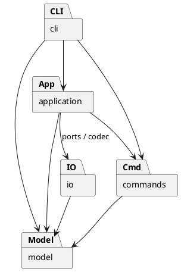

# PJ1 Phase 1：CLI SVG 编辑器

## 架构方案（开发起点）

采用 TypeScript 严格模式，一类一文件。计划模块如下：

| 目录 | 职责 |
| --- | --- |
| `src/model` | 图形抽象、六种图形、树结构与文档不变量；不依赖 IO |
| `src/commands` | Command 接口、每种编辑命令、历史管理；依赖 model |
| `src/application` | 当前文档会话、文档操作；依赖 commands、model 和 IO 接口 |
| `src/io` | 文件端口和 SVG XML 编解码；依赖 model |
| `src/cli` | 分词、命令分发、展示和 REPL；依赖 application 与命令 |
| `src/main.ts` | 装配文件适配器和 CLI |
| `test`、`examples` | 自动化测试、可回放的命令案例 |

使用 Command 表达单次编辑，Composite 统一容器和叶子操作，Memento 为命令保存前后文档快照，以保证失败原子性并精确撤销结构修改。图形工厂集中类型创建。命令名分发和图形工厂是仅有的两处按名称分派，标记为后续插件化阶段待重构点。

依赖禁止反向：model 不知道命令或 XML，commands 不知道 CLI 和文件系统，文件 IO 不知道命令历史。未来图形类型、命令入口和存储介质可能变化，分别以图形继承/工厂、Command、文件端口隔离；本阶段不实现 box 或插件加载器，不预建无需求框架。

## 过程记录

- 2026-10-22：用户提供交付要求。Codex 检查发现目录仅有 `phase_cli_1.md`，无既有代码或 Git 仓库；读取原说明后确认必须使用 TypeScript、Command 和 Composite，决定从架构与工具链开始分步提交。远程仓库地址待用户提供。

## 一致性自查

待实现后依据实际代码和测试结果补充，不将计划当作已完成成果。

## 功能完整性和质量保证手段

计划验证六种图形、嵌套容器、分组顺序、循环拒绝、单命令撤销重做、IO 历史屏障、失败原子性、XML 往返和 CLI 脚本。最终测试结果将在完成后记录。
